# PanelCraft

**English** · [Türkçe](README.tr.md) · [Website](https://panelcraft.github.io/panelcraft/) · [Download](https://github.com/panelcraft/panelcraft/releases/latest)

PanelCraft is a web moderation panel for Minecraft servers. You open it in a browser and see your players, chat, world and backups in one place. It runs inside the server as a mod or plugin (Forge, NeoForge, Fabric, Paper), or as a separate program next to an unmodified vanilla server, which it talks to over RCON.

You don't need to know any programming. If you can copy a file into a folder and edit a text file, you can install it. This guide goes through every step.

---

## Contents

- [Screenshots](#screenshots)
- [Features](#features)
- [Which file do I download?](#which-file-do-i-download)
- [Requirements](#requirements)
- [Install](#install)
- [First start: claim your panel](#first-start-claim-your-panel)
- [Adding moderators](#adding-moderators)
- [Changing the language](#changing-the-language)
- [Securing the panel](#securing-the-panel)
- [Updating](#updating)
- [Backups and restore](#backups-and-restore)
- [Uninstalling](#uninstalling)
- [Commands](#commands)
- [Troubleshooting](#troubleshooting)
- [Licence](#licence)
- [Reporting problems](#reporting-problems)

---

## Screenshots

| | |
|---|---|
| 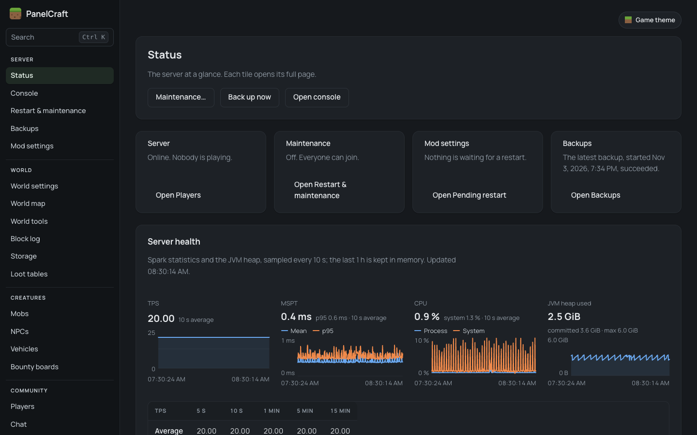 **Status:** the server at a glance | 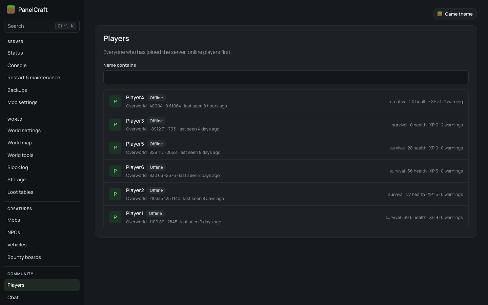 **Players:** everyone who has joined |
| 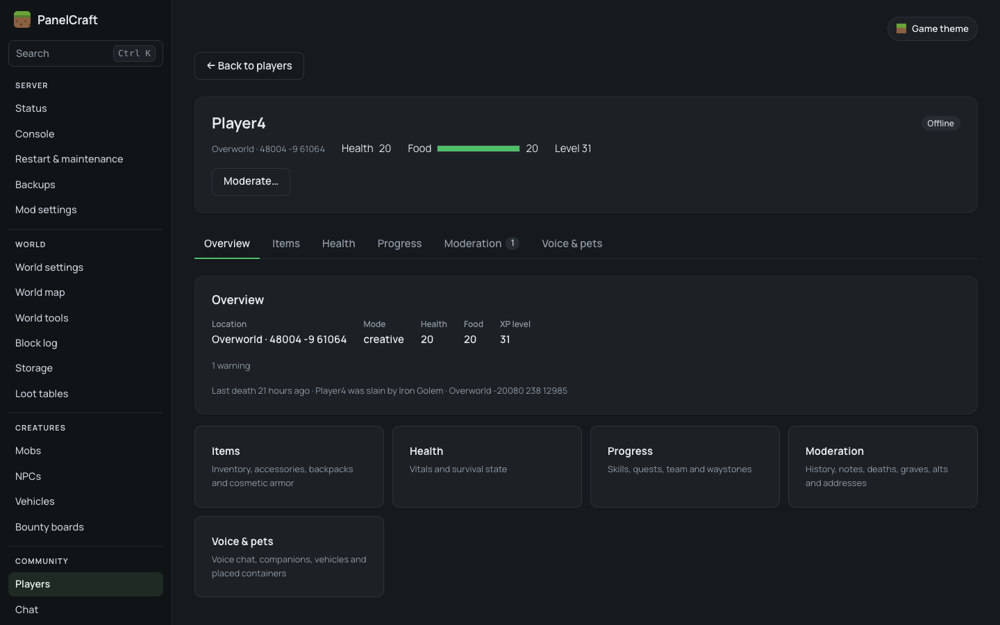 **Profile:** inventory, history, actions | 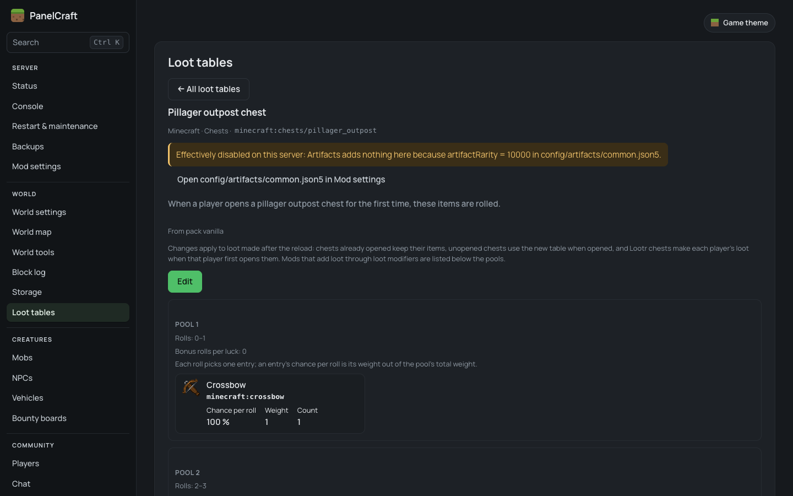 **Loot detail:** items, conditions and what mods add |
| 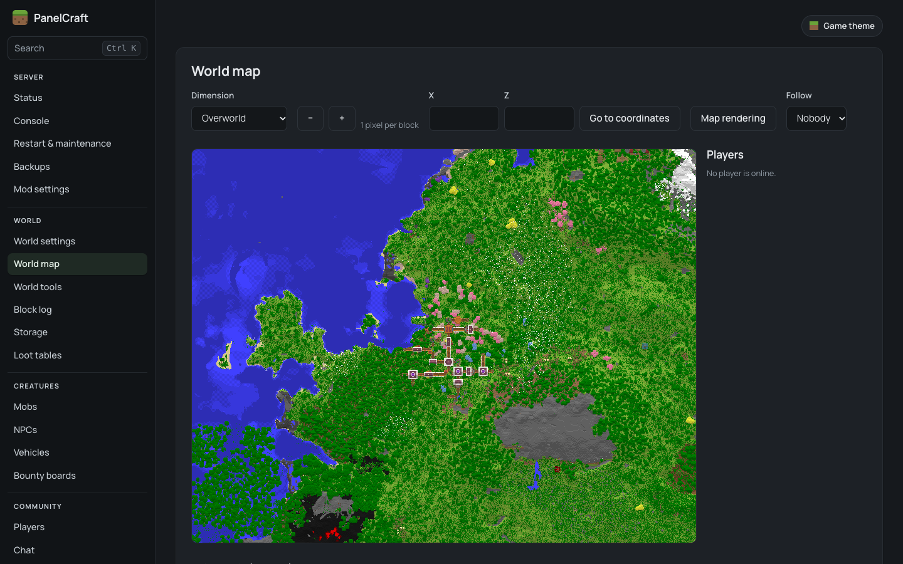 **World map:** drawn from your saved world | 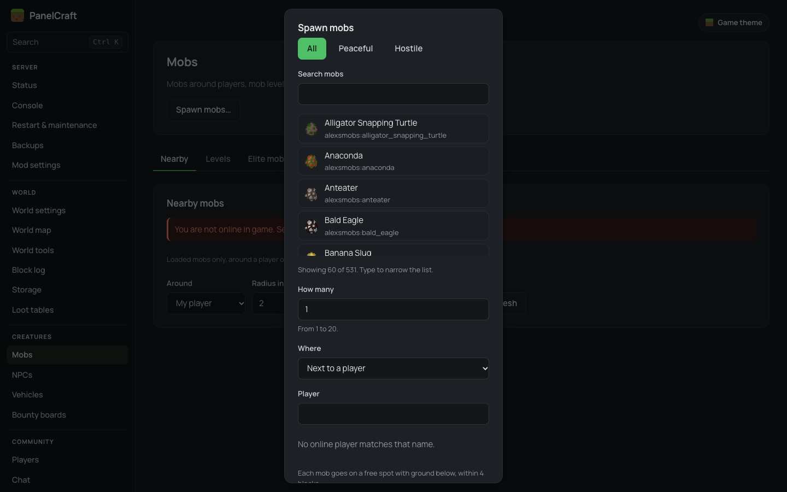 **Mobs:** see and spawn mobs |
| 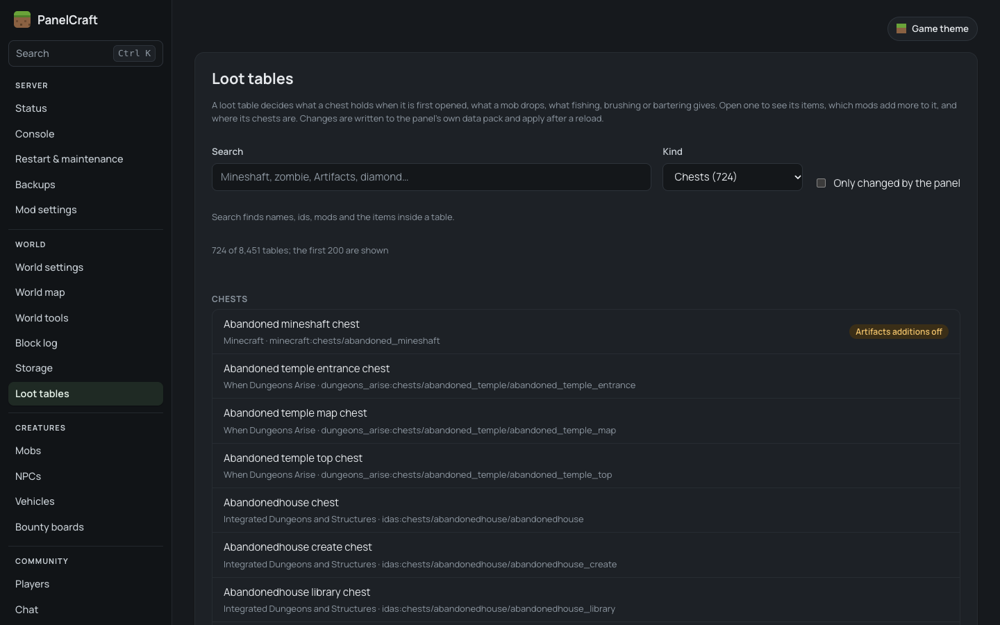 **Loot tables:** what chests and mobs give | 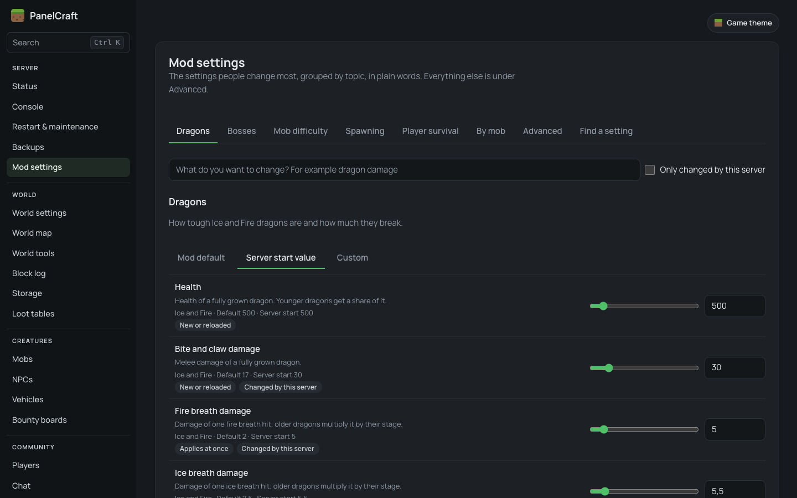 **Mod settings:** edit mod configs safely |
| 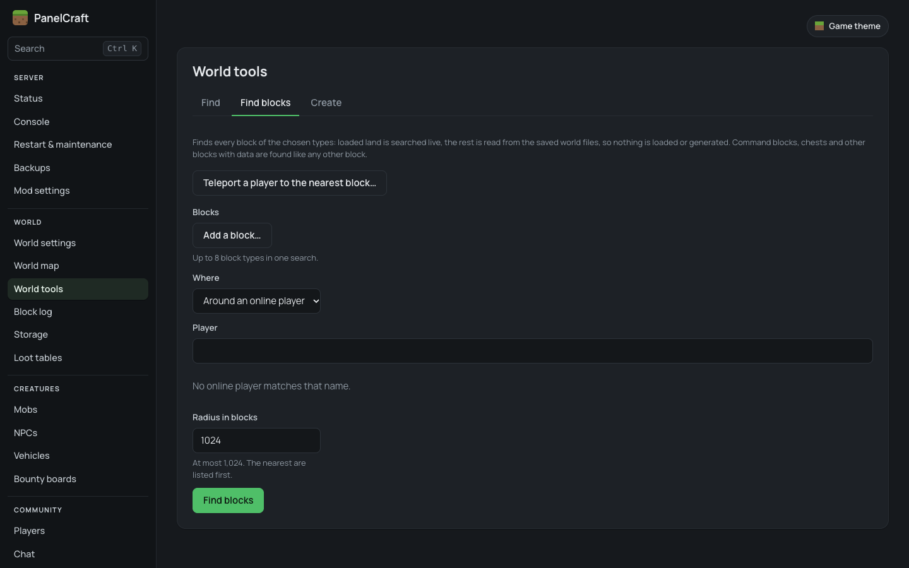 **World tools:** find blocks and structures | 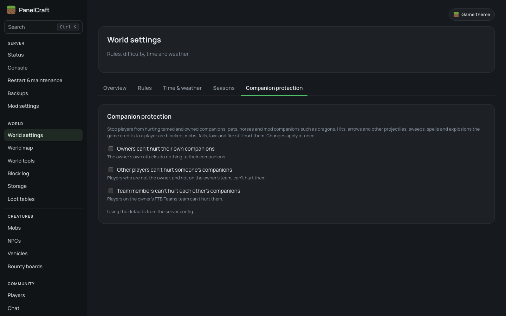 **Companion protection:** keep pets safe |
| 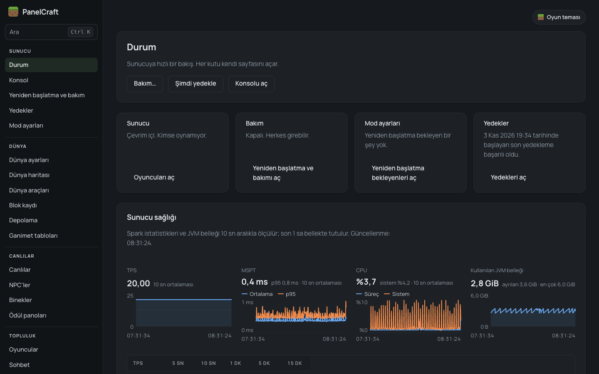 **Türkçe:** the whole panel in Turkish | 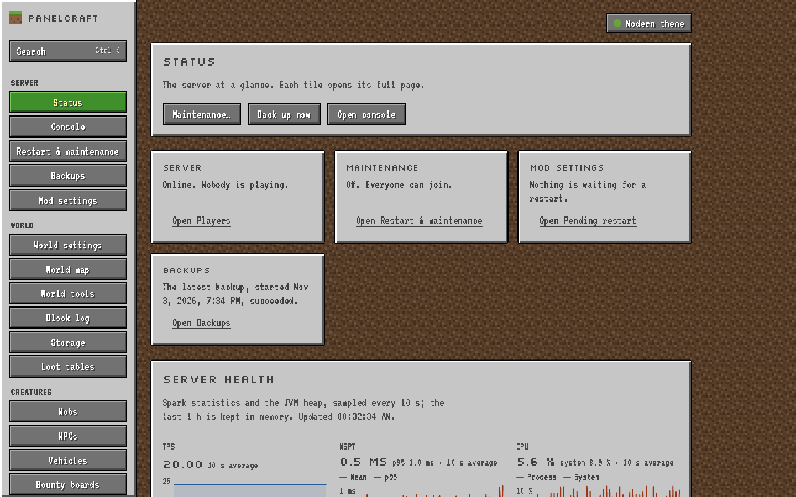 **Game theme:** a Minecraft-style look |

---

## Features

The list follows the panel's sidebar. What you see depends on your server type (see [what each server type can do](#what-each-server-type-can-do)) and on your role's permissions.

### Server
- **Status**: the server at a glance; each tile opens its full page. With the [Spark](https://spark.lucko.me/) mod a read-only "Server health" card is added (Forge 1.20.1).
- **Console**: the live server console, and running commands for roles that are allowed to.
- **Restart & maintenance**: restart after a countdown (10 seconds to 10 minutes) that players see in chat, and maintenance mode (only staff can be online; everyone else is warned, then kicked).
- **Backups**: zip backups of the whole world, on demand or on a schedule, download them, and restore a world (owner only).
- **Mod settings**: change mod configuration from the browser. On Forge and NeoForge each setting shows what it does and how risky it is, and settings that only apply at start-up are prepared for the next start. On Fabric and Paper you get a file editor.
- **Modules** (owner only): switch parts of the panel off or on. **Data** (owner only): backups and audit clean-up.

### World
- **World settings**: game rules, difficulty, time and weather. The **Companion protection** card stops players from hurting pets and other companions.
- **World map**: a top-down map drawn from the saved world files (it never loads chunks), with live player positions.
- **World tools**: find the nearest structure, biome or point of interest without loading or generating chunks; find blocks across the explored world; place a bee nest, a feature or a structure.
- **Block log**: who broke, placed or blew up which blocks, and when. Roll griefing back without restoring a backup, and undo the rollback.
- **Storage**: who opened, filled, emptied, placed or broke a container, plus an index of containers in the world.
- **Loot tables**: see what a chest, mob, fishing or bartering gives, and change it. Changes go into the panel's own data pack and apply after a reload.

### Creatures
- **Mobs**: loaded mobs around a player or a point, and spawning any mob next to a player or at coordinates.
- **Vehicles**: boats and minecarts (plus modded vehicles), spawning them, and a ride log. Pets, horses and other companions show on their owner's profile.
- **NPCs** and **Bounty boards**: only with the Easy NPC and Bountiful mods.

### Community
- **Players**: a profile for every player: inventory, ender chest, deaths (with restore), giving and editing items, XP, effects, attributes and advancements, staff notes, alternative accounts, sanction history. Actions: message, teleport, game mode, heal, kick, warn, mute, freeze, vanish, temporary and permanent bans.
- **Chat**: live chat and a searchable chat log. On mod and plugin servers private and team messages are logged too. By default every player who joins is told that chat is recorded (you can change this in the config).
- **Reports**: reports players send in game with `/report <player> <reason>`.
- **Bans**: all bans and warnings in one list.
- **Chat filter**: banned words and what happens to players who use them (block, censor, warn, mute, temporary ban, with escalating steps).
- **Game logins**: for offline-mode ("cracked") servers. Players protect their name with `/register` and `/login`, and staff can reset a forgotten in-game password.

### Panel
- **Users**: staff accounts, invitations, disabling accounts, resetting two-factor.
- **Roles**: ranks and permissions, with ready-made **Player**, **Moderator** and **Admin** templates. Dangerous permissions are marked and need confirmation. A role can require two-factor sign-in.
- **Audit log**: every panel action, who did it and when.
- **Account**: your password, two-factor sign-in, panel language, time zone, colour scheme (light, dark, auto) and theme.

Across the panel you can press **Ctrl K** to search pages and actions, and item, block and mob names come from the game's own language files (English and Turkish).

### Mod integrations (Forge 1.20.1 only)

On **Forge 1.20.1** PanelCraft adds pages and profile sections for the following mods (built for the mod set of the Legendary Edition modpack). Each one switches on **only when that mod is installed**. A mod version PanelCraft was not tested with still loads, with a warning in the log. On other loaders these integrations don't exist yet.

Legendary Survival Overhaul, Reskillable, Iron's Spells 'n Spellbooks, Curios, Backpacked, Cosmetic Armor Reworked, Feathers, Paraglider, FTB Quests, FTB Teams, Waystones, Gravestone, Simple Voice Chat, Ice and Fire, Immersive Aircraft, AstikorCarts, Serene Seasons, Lootr, Tom's Simple Storage, Bountiful, Easy NPC, AutoLeveling, Infernal Mobs, Spawn Cap Control, Spawn Balance, Harder Spawners, Spark, Map Atlases, Quality Equipment, Supplementaries, Quark, Relics, FastAsyncWorldSave, Artifacts.

### What each server type can do

| Feature | Forge 1.20.1 | NeoForge 1.21.1 / 26.3 | Fabric 1.20.1 / 1.21.1 | Paper 1.21.1 / 26.3 | Vanilla (standalone) |
|---|---|---|---|---|---|
| Players, inventories, player state, item give | yes | yes | yes | yes | online players over RCON; offline players read-only; no item editing |
| Bans, warnings, alts | yes | yes | yes | yes | yes |
| Mute, freeze, vanish, reports, in-game login | yes | yes | yes | yes | no |
| Live chat, console, chat log | yes | yes | yes | yes | from the server log (no private messages) |
| Chat filter | blocks and censors | blocks and censors | blocks and censors | blocks and censors | acts after the message (can't block it) |
| World settings, restart, maintenance | yes | yes | yes | yes | yes |
| World tools, mobs, world map | yes | yes | yes | yes | no |
| Block log, storage | yes | yes | yes | yes (vanilla containers) | no |
| Companions, loot tables | yes | yes | yes (no loot modifiers) | yes (no loot modifiers) | no |
| Mod settings | per-setting editor | per-setting editor | file editor | file editor | no |
| Backups, world restore | yes | yes | yes | yes | backups; restore prepares a copy you swap by hand |
| Mod integrations (list above) | yes | no | no | no | no |

Fabric's block log does not record buckets, fire and the second half of beds and doors. On NeoForge 26.3 and Paper 26.3, the features that act on online players have not been tested with a real 26.3 game client yet.

---

## Which file do I download?

Go to the **[latest release](https://github.com/panelcraft/panelcraft/releases/latest)** and download **one** file that matches your server:

| Your server | Minecraft version | Download | Put it in |
|---|---|---|---|
| Forge (47.x) | 1.20.1 | `panelcraft-forge-1.20.1-0.1.0.jar` | `mods/` |
| NeoForge (21.1.x) | 1.21.1 | `panelcraft-neoforge-1.21.1-0.1.0.jar` | `mods/` |
| NeoForge (26.3.x) | 26.3 | `panelcraft-neoforge-26.3-0.1.0.jar` | `mods/` |
| Fabric (Loader 0.20.1 or newer + Fabric API) | 1.20.1 | `panelcraft-fabric-1.20.1-0.1.0.jar` | `mods/` |
| Fabric (Loader 0.20.1 or newer + Fabric API) | 1.21.1 | `panelcraft-fabric-1.21.1-0.1.0.jar` | `mods/` |
| Paper | 1.21.1 | `panelcraft-paper-1.21.1-0.1.0.jar` | `plugins/` |
| Paper | 26.3 | `panelcraft-paper-26.3-0.1.0.jar` | `plugins/` |
| Vanilla (no mods) | 1.20.1–1.20.6, 1.21–1.21.11, 26.1–26.3 | `panelcraft-standalone-0.1.0.jar` | its own folder (runs separately) |

- Each mod and plugin file works only on that exact Minecraft version.
- Spigot and Bukkit can't load the Paper files. Folia is not supported.
- Only the server needs PanelCraft. **Players don't install anything.**
- `SHA256SUMS.txt` on the release page lets you check that a download is complete.

Your Minecraft version is shown in the server list in the game, and in the first lines of the server console.

---

## Requirements

| | |
|---|---|
| **Java** | Forge 1.20.1, Fabric 1.20.1 and standalone: **Java 17** or newer. NeoForge 1.21.1, Fabric 1.21.1 and Paper 1.21.1: **Java 21**. NeoForge 26.3 and Paper 26.3: **Java 25**. A mod or plugin uses the server's own Java, which that Minecraft version already needs. |
| **Operating system** | Linux (x64, arm64), Windows (x64) or macOS (x64, Apple Silicon). The built-in database doesn't run on anything else. |
| **Memory** | PanelCraft runs inside the server's Java process and uses some of its memory. The map and the block search use more while they work. Leave some headroom over what your server needs now. |
| **Internet (server side)** | Recommended. The server downloads the official Minecraft client files from Mojang once for item icons and Turkish game names, looks up player names at Mojang on online-mode servers, and downloads player skins. Without internet the panel works, but vanilla items show text instead of icons and game names stay in English. |
| **Ports** | The panel uses port **8150**. By default it only answers on the server machine itself. See [Securing the panel](#securing-the-panel) before you make it reachable from other computers. Your game port (usually 25565) doesn't change. |
| **Vanilla only** | RCON turned on in `server.properties`, and PanelCraft on the **same machine** as the Minecraft server, because it reads the server's files. |

---

## Install

Before you start, **stop your server** and **make a backup of your world folder**.

The installs are almost the same for every server type. Open the one that matches your server.

<details>
<summary><b>Forge, NeoForge or Fabric (mod)</b></summary>

1. Stop the server.
2. Download the matching file from the [table](#which-file-do-i-download).
3. **Fabric only:** make sure [Fabric API](https://modrinth.com/mod/fabric-api) is in the `mods/` folder too. PanelCraft doesn't load without it.
4. Copy the PanelCraft `.jar` into the server's `mods/` folder.
5. Start the server.
6. Watch the console. When the server has started you should see these two lines:
   ```
   PanelCraft setup code written to config/panelcraft/one-time-code.txt
   PanelCraft listening on port 8150
   ```
7. PanelCraft has created:
   - `config/panelcraft.toml`: the settings file,
   - `config/panelcraft/`: the panel's data folder (database, the one-time code, caches).
8. Continue with [First start: claim your panel](#first-start-claim-your-panel).

</details>

<details>
<summary><b>Paper (plugin)</b></summary>

1. Stop the server.
2. Download the matching file from the [table](#which-file-do-i-download).
3. Copy the PanelCraft `.jar` into the server's `plugins/` folder.
4. Start the server.
5. Watch the console. When the server has started you should see these two lines:
   ```
   PanelCraft setup code written to plugins/PanelCraft/one-time-code.txt
   PanelCraft listening on port 8150
   ```
6. PanelCraft has created:
   - `config/panelcraft.toml`: the settings file. On Paper too it lives in the server's `config/` folder, next to Paper's own files, **not** in `plugins/PanelCraft/`.
   - `plugins/PanelCraft/`: the panel's data folder (database, the one-time code, caches).
7. Continue with [First start: claim your panel](#first-start-claim-your-panel).

</details>

<details>
<summary><b>Vanilla server (standalone program)</b></summary>

On a vanilla server nothing is installed into Minecraft. PanelCraft runs as its own program on the same machine, reads the server's files and sends commands over RCON.

**1. Turn on RCON.** Stop the Minecraft server, open its `server.properties` and set:

```properties
enable-rcon=true
rcon.port=25575
rcon.password=PUT-A-LONG-RANDOM-PASSWORD-HERE
```

Start the Minecraft server again. PanelCraft reads these values itself and never changes `server.properties`. **Don't open port 25575 in your firewall or router**: only PanelCraft on the same machine uses it.

**2. Make a folder for PanelCraft**, next to the Minecraft server folder, not inside it. For example:

```
/srv/minecraft     ← your Minecraft server (has server.properties)
/srv/panelcraft    ← new, empty folder for PanelCraft
```

**3.** Put `panelcraft-standalone-0.1.0.jar` into the new folder.

**4. Start it once** from inside that folder:

```
java -jar panelcraft-standalone-0.1.0.jar
```

It creates `config/panelcraft.toml` and stops with a message that it cannot find `server.properties`. That's expected.

**5. Point it at your server.** Open `config/panelcraft.toml` and change `server_dir` under `[standalone]` to the Minecraft server folder:

```toml
[standalone]
server_dir = "/srv/minecraft"
secret_output = "file"
```

On Windows use forward slashes or double backslashes, for example `server_dir = "C:/minecraft"`.

**6. Start it again**, the same way. You should see:

```
PanelCraft setup code written to config/panelcraft/one-time-code.txt
PanelCraft 0.1.0 listening on http://127.0.0.1:8150
```

If RCON is off or has no password, PanelCraft stops and prints the exact lines to add to `server.properties`. If the Minecraft server stops or restarts, PanelCraft keeps running and reconnects every 5 seconds.

**7. Keep it running.** To stop PanelCraft, type `stop` (or `panelcraft stop`) in its console, or press Ctrl+C. To start it automatically on Linux you can use systemd:

```ini
[Unit]
Description=PanelCraft
After=network.target minecraft.service

[Service]
User=minecraft
WorkingDirectory=/srv/panelcraft
ExecStart=/usr/bin/java -jar panelcraft-standalone-0.1.0.jar
Restart=on-failure
RestartSec=5

[Install]
WantedBy=multi-user.target
```

**Good to know on vanilla:**
- On first start PanelCraft adds a small data pack, `<world>/datapacks/panelcraft/`, and reloads data packs. It's needed for `/trigger panelcraft set <code>` (linking).
- Linking a Minecraft account only works with `online-mode=true`. On an offline-mode server anyone can join under any name, so (unless in-game login is on) you create panel accounts from the console with `panelcraft adduser <name>` instead (see [Adding moderators](#adding-moderators)).
- There is no in-game `/login` protection on vanilla.
- The data folder is `config/panelcraft/` inside PanelCraft's folder.

Continue with [First start: claim your panel](#first-start-claim-your-panel).

</details>

<details>
<summary><b>Hosted panels: PufferPanel, Pterodactyl and similar</b></summary>

Hosting panels show the same server folder in their **File Manager**. Use it for every step above.

**Mod or plugin server**

1. Stop the server in the hosting panel.
2. In the File Manager, open `mods/` (Forge, NeoForge, Fabric) or `plugins/` (Paper) and upload the PanelCraft `.jar`.
3. Start the server and watch the hosting panel's **Console** for `PanelCraft listening on port 8150`.
4. Open the one-time code file in the File Manager: `config/panelcraft/one-time-code.txt` (or `plugins/PanelCraft/one-time-code.txt` on Paper).
5. **Reaching the panel.** The panel needs its own network port, and by default it only listens on the machine itself.
   - On **Pterodactyl** (and hosts built on it) each server runs in its own container. Add a second port to the server (the **Network** tab, if your host allows extra allocations), then in `config/panelcraft.toml` set:
     ```toml
     [web]
     bind = "0.0.0.0"
     port = 25580        # the extra port your host gave you
     ```
   - On **PufferPanel** servers run straight on the machine. Pick a free port, open it in the machine's firewall, and set `bind`/`port` the same way.
   - Restart the server, then open `http://<server address>:<port>` in your browser.
   - **Read [Securing the panel](#securing-the-panel) first.** Without HTTPS, passwords travel over the internet unencrypted. If your host offers a domain with HTTPS or a reverse proxy, use it.
6. **Restarts.** PanelCraft can only *stop* the server for a restart or a world restore; the hosting panel has to start it again. See [the `[restart] supervised` setting](#restarts-and-the-supervised-setting).
7. The hosting panel's console works as the server console for commands like `panelcraft reset <name>`.

**Vanilla (standalone) on PufferPanel**

Add PanelCraft as a **separate server entry** next to the Minecraft one, not inside it. Give it its own folder and the start command `java -jar panelcraft-standalone-0.1.0.jar`, and set `server_dir` in its `config/panelcraft.toml` to the Minecraft server's folder. Stopping it with `stop` (PufferPanel's default stop command) is a clean shutdown; don't use **Kill**, which skips it.

On Pterodactyl every server has its own isolated container, so a separate PanelCraft program usually can't read the Minecraft server's files. Use a Paper or Fabric server with the plugin or mod build instead.

</details>

### Opening the panel in your browser

- **On the server machine itself:** open <http://127.0.0.1:8150>.
- **From your own computer, server elsewhere (safest quick way):** use an SSH tunnel. In a terminal on your computer run
  `ssh -L 8150:127.0.0.1:8150 youruser@your-server`
  and, while it stays open, browse to <http://127.0.0.1:8150> on your computer.
- **Permanently, for your whole staff:** put the panel behind HTTPS. See [Securing the panel](#securing-the-panel).

### Restarts and the `supervised` setting

PanelCraft **only stops** the server for a restart or a world restore. Something else must start it again: PufferPanel, Pterodactyl, systemd, or a loop in your start script. Until you confirm that, the panel warns before every restart that the server will stay off.

Once your server comes back on its own after it stops, open `config/panelcraft.toml` and set:

```toml
[restart]
supervised = true
```

To test it: on the **Restart & maintenance** page, start a restart with a short countdown and check that the server starts again by itself. Restart the server once more afterwards so the setting is read.

---

## First start: claim your panel

The first person to enter the one-time setup code becomes the **owner** of the panel. The owner can do everything and can't be locked out by other staff.

### 1. Find the setup code

Open the code file. Where it is:

| Server type | Code file |
|---|---|
| Forge, NeoForge, Fabric | `config/panelcraft/one-time-code.txt` |
| Paper | `plugins/PanelCraft/one-time-code.txt` |
| Vanilla (standalone) | `config/panelcraft/one-time-code.txt` in PanelCraft's own folder |

The file contains one line like this:

```
SETUP_OWNER - ABCDEF123456 valid until never
```

The code is the part between `-` and `valid` (here `ABCDEF123456`). It works once and doesn't expire, but a new code replaces it each time the server starts until an owner exists. The file is deleted after setup.

> On vanilla you can set `secret_output = "console"` under `[standalone]` to print codes to PanelCraft's console instead of a file.

### 2. Create the owner account

1. Open the panel in your browser. You will see **Claim this server**.
2. Enter the **Setup code**.
3. Enter your **Minecraft player name**, exactly as it is in the game. On online-mode servers it is checked with Mojang.
4. Choose a password: **at least 10 characters**. Type it again.
5. Click **Create owner account**.

Your panel account is now tied to that Minecraft character. You don't need a separate link step.

### 3. Turn on two-factor sign-in

The owner must use two-factor sign-in, so the panel asks for it straight away (**Set up two-factor**):

1. Install an authenticator app on your phone, for example Aegis, 2FAS or Google Authenticator.
2. Scan the QR code with the app (or type in the key shown under it).
3. Enter the 6-digit code the app shows, then **Turn on two-factor**.

From now on, signing in asks for your player name, password and the current 6-digit code. There are no backup codes. If you lose your phone, see [Forgot my password or lost my phone](#forgot-my-password-or-lost-my-phone).

Other staff can turn two-factor on under **Account → Two-factor sign-in → Turn on two-factor…**. A role can require it (the Admin template does).

---

## Adding moderators

Every staff member gets their own panel account tied to their Minecraft character, and a **role** that decides what they can do.

### 1. Create a role from a template

1. Go to **Panel → Roles** and click **New role from template…**.
2. Pick a template and click **Use**. The form is filled in; nothing is saved yet.
3. Check it and click **Create role**. Dangerous permissions need a confirmation box and your password.

| Template | Rank | Two-factor | What it can do |
|---|---|---|---|
| **Player** | 10 | no | Nothing in the panel. Members can only sign in and manage their own account. |
| **Moderator** | 100 | no | Watch players and chat, handle reports, warn, mute, freeze, kick, temporary bans, vanish, announcements, and read-only views of inventories, storage, block log and mod data. No permanent bans, no teleport, no world changes, no console. |
| **Admin** | 500 | required | Everything except running console commands and deleting backups. World restore, modules, data, restart and owner transfer always stay with the owner. |

A role's **rank** matters: staff can only manage users and roles ranked **below** their own.

### 2. Add the person

The person must have joined the server at least once.

1. Go to **Panel → Users** and click **Add user…**, pick the player and the role.
2. Tell them to finish it themselves:
   1. On the panel's sign-in page, choose **First time here? Link your character**.
   2. Enter their player name and click **Get a code**.
   3. Join the server and type in game:
      - mod or plugin server: `/panelcraft link <code>`
      - vanilla server: `/trigger panelcraft set <code>`
   4. Choose a panel password. The role applies right away.

The invitation is valid for 72 hours (`[users] invite_hours`). A player can also link without an invitation: they then see **Waiting for a role** until you give them one with **Change role…** on the Users page.

**Offline-mode servers** (vanilla, or a mod/plugin server without in-game login): linking isn't available. Run `panelcraft adduser <name>` in the server console (on vanilla: PanelCraft's own console). It writes a one-time code (to the code file, valid 30 minutes); the player chooses **Use a reset code** on the sign-in page, enters it and sets a password. Then give them a role on the Users page.

**Offline-mode mod/plugin servers:** with in-game login on (the default, see below), linking works as above, because players have proven their name with `/login`.

### In-game login on offline-mode servers

On an offline-mode server anyone can join under any name. With the default `[game_login] mode = "auto"`, PanelCraft protects names on mod and plugin servers that run in offline mode:

- New players type `/register <password> <password>`, returning players `/login <password>` (at least 6 characters) within 60 seconds of joining.
- Until then they are frozen and can't chat, use commands, break or place blocks or touch their inventory.
- Forgotten in-game password: **Community → Game logins** gives a one-time code; the player rejoins and types `/register <code> <password> <password>`.

`mode = "on"` always enforces it, `mode = "off"` never does. On online-mode servers `auto` leaves it off, because Mojang already checks who is who. Restart the server after changing `online-mode` or this setting.

---

## Changing the language

The panel speaks **English** and **Turkish**.

- Each person chooses for themselves: **Account → Language → Panel language**. Without a choice the panel follows the browser's language.
- Item, block and mob names come from the game's and the mods' own language files. Vanilla's Turkish names are downloaded once from Mojang (that needs `download_client_jar = true` under `[assets]`, which is the default, and internet on the server). A mod that has no Turkish file shows its names in English.
- Messages players see in game (join notice, maintenance warnings, backup announcements and so on) are set in `config/panelcraft.toml`. Change them there if you want them in another language.

---

## Securing the panel

The panel can ban players, edit inventories and, for some roles, run console commands. Treat it like your server's admin password.

**The rules:**

1. **Don't make port 8150 reachable from the internet over plain `http://`.** Passwords and session cookies would travel unencrypted. By default the panel only listens on `127.0.0.1` (the machine itself), which is safe.
2. For access from other computers, put it behind **HTTPS** with a reverse proxy (below), or use an SSH tunnel.
3. Changing `bind = "0.0.0.0"` is fine on a home network you trust, or when your host gives you no other way. Then use strong passwords and two-factor for everyone.
4. **Never open the RCON port** (vanilla, usually 25575).
5. Give operator (op) rights only to people you would trust with panel accounts. On vanilla, an operator can confirm someone else's link request with a scoreboard command.
6. Keep `function-permission-level` in `server.properties` at its default (2). At level 4, data pack functions run with console rights and could issue panel password reset codes.

### Reverse proxy with HTTPS

Keep the panel on `127.0.0.1:8150` and let a web server on the same machine handle HTTPS. PanelCraft's defaults already fit this:

```toml
[web]
bind = "127.0.0.1"
port = 8150

[security]
trusted_proxies = ["127.0.0.1", "::1"]
secure_cookies = "auto"
```

- `trusted_proxies` lists the addresses PanelCraft accepts `X-Forwarded-For` and `X-Forwarded-Proto` headers from. Write single addresses (no ranges like `/24`). If your proxy runs on another machine, or reaches the panel through a Docker network, add that exact address. An invalid entry stops the panel from starting.
- `secure_cookies = "auto"` marks the sign-in cookie as HTTPS-only whenever the request came over HTTPS (directly, or from a trusted proxy that sent `X-Forwarded-Proto: https`). `"always"` and `"never"` force it. Leave it on `auto`.
- The proxy **must pass the original `Host` header** and allow **WebSockets**, otherwise the live Chat and Console pages are refused.

**Caddy** (gets an HTTPS certificate automatically; replace the domain with yours):

```
panel.example.com {
    reverse_proxy 127.0.0.1:8150
}
```

**nginx** (with a certificate you already have, for example from Let's Encrypt / certbot):

```nginx
server {
    listen 443 ssl;
    server_name panel.example.com;

    ssl_certificate     /etc/letsencrypt/live/panel.example.com/fullchain.pem;
    ssl_certificate_key /etc/letsencrypt/live/panel.example.com/privkey.pem;

    location / {
        proxy_pass http://127.0.0.1:8150;
        proxy_http_version 1.1;
        proxy_set_header Host $host;
        proxy_set_header X-Forwarded-For $proxy_add_x_forwarded_for;
        proxy_set_header X-Forwarded-Proto $scheme;
        proxy_set_header Upgrade $http_upgrade;
        proxy_set_header Connection "upgrade";
    }
}
```

### Firewall basics

| Port | What | Open to the internet? |
|---|---|---|
| 25565 (or yours) | The Minecraft game | Yes, as before |
| 443 (and 80 for the certificate) | Your reverse proxy (HTTPS) | Yes, if you use one |
| 8150 | The PanelCraft panel itself | **No** (only with HTTPS in front, or on a trusted LAN) |
| 25575 | RCON (vanilla) | **Never** |

Example on Ubuntu with `ufw`, using a reverse proxy: `sudo ufw allow 25565/tcp`, `sudo ufw allow 80/tcp`, `sudo ufw allow 443/tcp`, and don't add 8150 or 25575.

---

## Updating

1. Download the new file for your server from the [latest release](https://github.com/panelcraft/panelcraft/releases/latest).
2. Stop the server (on vanilla: stop PanelCraft too).
3. Optional but wise: copy the panel's data folder (`config/panelcraft/`, or `plugins/PanelCraft/` on Paper) somewhere safe.
4. **Delete the old PanelCraft jar** and put the new one in its place. Two PanelCraft jars in `mods/` or `plugins/` at once won't work.
5. Start the server. The database is upgraded automatically.

Your `config/panelcraft.toml` is kept. New settings that a newer version adds use their default value until you add them to the file.

---

## Backups and restore

**Backups** (Server → Backups) are zip files of the whole world folder, made while the game keeps running.

- Click **Back up now** on the page. Scheduled backups are off by default. Turn them on in `config/panelcraft.toml`:
  ```toml
  [backups]
  directory = "backups"     # where the zip files go
  interval_minutes = 360    # 0 = no scheduled backups
  keep_count = 7            # keep the newest 7
  ```
- `directory` is relative to the server folder (on vanilla: to PanelCraft's folder) and can't be inside the world folder.
- A backup only starts when there is free disk space for the world size plus 1 GB.
- Backups can be downloaded from the page (with the right permission).

**Restoring** a world is for the owner only.

- **Mod and plugin servers:** maintenance mode switches on and warns players with a countdown, the server restarts, and the world folder is swapped before the world loads. Your current world is kept next to it as `<world>.before-restore-<time>`, and the restore can be undone. This needs the server to come back after it stops: see [`supervised`](#restarts-and-the-supervised-setting).
- **Vanilla:** the backup is unpacked next to the world as a new folder. The page shows the steps to swap the folders yourself while the server is stopped. PanelCraft notices the swap when the server starts again.

Back up the panel itself by copying its data folder (`config/panelcraft/` or `plugins/PanelCraft/`) and `config/panelcraft.toml` while the server is stopped.

---

## Uninstalling

1. Stop the server.
2. Delete the PanelCraft jar from `mods/` or `plugins/` (vanilla: stop PanelCraft and delete its folder).
3. These stay behind. Delete them if you don't need them:

| What | Where |
|---|---|
| Settings | `config/panelcraft.toml` |
| Panel data: accounts, logs, caches (contains password hashes) | `config/panelcraft/` (Paper: `plugins/PanelCraft/`) |
| World backups | `backups/` (or the folder you set) |
| Panel data packs, if you edited loot or mob levels | `<world>/datapacks/panelcraft_loot/`, `<world>/datapacks/panelcraft_leveling/` |
| Linking data pack (vanilla) | `<world>/datapacks/panelcraft/` |
| Worlds kept by a restore | `<world>.before-restore-…`, `<world>.restored-…` next to your world |

Mod settings you changed through the panel stay changed in the mods' own config files.

---

## Commands

**Server console** (type without `/`; in game they are refused):

| Command | What it does |
|---|---|
| `panelcraft reset <name>` | Clears that panel user's password **and two-factor**, signs them out and writes a reset code (valid 30 minutes). |
| `panelcraft adduser <name>` | Creates a panel account without a role and writes a one-time code. Works on every server type; on mod and plugin servers run it in the server console. |
| `panelcraft help` | Lists the commands. |
| `stop` or `panelcraft stop` | Vanilla (standalone) only: stops PanelCraft cleanly. |

**In game:**

| Command | Who | Where |
|---|---|---|
| `/panelcraft link <code>` | Anyone linking a panel account | mod and plugin servers |
| `/trigger panelcraft set <code>` | Anyone linking a panel account | vanilla, online mode |
| `/report <player> <reason>` | Players | mod and plugin servers |
| `/panelcraft timezone [<zone> \| reset]` | Players, e.g. `Europe/Istanbul` | mod and plugin servers |
| `/register <password> <password>`, `/login <password>` | Players | offline-mode mod and plugin servers with in-game login |

---

## Troubleshooting

<details>
<summary><b>The page doesn't open in the browser</b></summary>

1. Look for `PanelCraft listening on port 8150` in the console. If it isn't there, look a few lines up for a line starting with `PanelCraft` that says what went wrong.
2. By default the panel only answers on the server machine itself (`127.0.0.1`). From another computer use an SSH tunnel, a reverse proxy, or set `bind = "0.0.0.0"` under `[web]` (read [Securing the panel](#securing-the-panel) first) and restart.
3. Open the port in the firewall, or on a hosted panel make sure the port is one your host gave the server.
4. Use `http://`, not `https://`, when you connect straight to port 8150. The panel itself doesn't do HTTPS; a reverse proxy does.

</details>

<details>
<summary><b>Port 8150 is already in use</b></summary>

Something else uses the port, often a second server on the same machine with PanelCraft too. The console then says the port is in use and the game keeps running without the panel. Pick another port in `config/panelcraft.toml`:

```toml
[web]
port = 8151
```

and restart. Each server on one machine needs its own port.

</details>

<a id="forgot-my-password-or-lost-my-phone"></a>

<details>
<summary><b>Forgot my password or lost my phone</b></summary>

In the **server console** (or the hosting panel's console) type:

```
panelcraft reset <your panel name>
```

This clears the password **and** two-factor of that account and writes a reset code to the code file (same place as the setup code; on vanilla it is printed instead when `secret_output = "console"`). The line looks like `RESET <name> <code> valid until <time>`. The code is valid for **30 minutes**. On the sign-in page choose **Use a reset code**, enter the code and a new password. If your role requires two-factor (the owner always does), you set it up again right after.

Other staff can also ask a user manager to **reset two-factor** for them on the Users page.

</details>

<details>
<summary><b>"This account is locked"</b></summary>

After 5 wrong sign-ins to an account from the same browser or address, that account is locked there for 15 minutes; after 50 wrong sign-ins from anywhere it is locked for everyone. Wait, or use `panelcraft reset <name>` in the console. The numbers are under `[security]` in the config.

</details>

<details>
<summary><b>The server doesn't come back after a restart or restore</b></summary>

PanelCraft only stops the server; your host must start it again. Turn on your hosting panel's automatic restart, use systemd with `Restart=`, or a loop in the start script. Then set `supervised = true` under `[restart]` ([details](#restarts-and-the-supervised-setting)). Until then, start the server by hand after a restart.

</details>

<details>
<summary><b>Item and mob names show in English, or items have no icons</b></summary>

Vanilla icons and Turkish names come from the official Minecraft client files, which the server downloads once from Mojang. Check:

- `download_client_jar = true` under `[assets]` (the default), and `languages` contains `"tr_tr"`.
- The server can reach the internet (Mojang's download servers `piston-meta.mojang.com` and `resources.download.minecraft.net`, and the download links they give). Some hosts block outgoing connections.
- The console says `PanelCraft downloaded and verified the Minecraft <version> client jar for item icons` and `... tr_tr language file`. If not, a line starting with `PanelCraft could not get the Minecraft` says why.

A mod without its own Turkish translation shows its names in English; that's normal.

</details>

<details>
<summary><b>The panel doesn't start after I edited the config</b></summary>

PanelCraft refuses settings it doesn't know or values out of range, and the game server keeps running without the panel. The console line `PanelCraft config could not be loaded` names the problem. Check the spelling, the quotes and the section names. If you are stuck, rename the file; a fresh default one is created at the next start.

</details>

<details>
<summary><b>Live Chat or Console says the connection was refused behind a proxy</b></summary>

Your reverse proxy must pass the original `Host` header and allow WebSockets. See the [nginx example](#reverse-proxy-with-https).

</details>

<details>
<summary><b>Vanilla: PanelCraft exits right away</b></summary>

- `Cannot find …/server.properties`: set `server_dir` under `[standalone]` to the Minecraft server folder.
- It prints lines about RCON: turn on RCON in `server.properties` as shown, restart Minecraft, then start PanelCraft again.

</details>

<details>
<summary><b>"Unsupported platform for the embedded database"</b></summary>

The server runs on a system the built-in database doesn't support. Supported: Linux x64 and arm64, Windows x64, macOS x64 and Apple Silicon.

</details>

<details>
<summary><b>Forge says "export package org.sqlite"</b></summary>

Another mod bundles the same database library without renaming it, and Forge refuses to load both. Remove one of the two mods, or ask that mod's author about it.

</details>

<details>
<summary><b>Single-player or LAN world (Forge 1.20.1)</b></summary>

The Forge build also runs in a single-player world opened to LAN. The setup code and the panel address are shown to the host in chat. The panel database is then kept inside the world folder (`<world>/panelcraft/`), with every panel password hash in it: **delete that folder before you share the world.** The other builds run on dedicated servers only.

</details>

---

## Licence

PanelCraft is **free to download and use**, including on commercial servers. It is **not open source**: you may not modify, decompile for redistribution, resell or re-upload the files elsewhere. It comes **as is, without warranty**. Read the full text in [LICENSE](LICENSE). Bundled open-source libraries keep their own licences; see [THIRD-PARTY-NOTICES.md](THIRD-PARTY-NOTICES.md).

## Reporting problems

The source code is not public. Please report bugs and ideas here, in [Issues](https://github.com/panelcraft/panelcraft/issues). Include your server type, Minecraft version, PanelCraft version, what you did, and the console lines starting with `PanelCraft`. **Remove passwords, codes, IP addresses and anything private before you post.**
