# PanelCraft

[English](README.md) · **Türkçe** · [Web sitesi](https://panelcraft.github.io/panelcraft/tr.html) · [İndir](https://github.com/panelcraft/panelcraft/releases/latest)

PanelCraft, Minecraft sunucuları için bir web yönetim panelidir. Tarayıcıda açarsınız; oyuncularınızı, sohbeti, dünyayı ve yedekleri tek yerden görürsünüz. Sunucunun içinde mod ya da eklenti olarak (Forge, NeoForge, Fabric, Paper) veya hiç değiştirilmemiş bir vanilla sunucunun yanında ayrı bir program olarak çalışır; vanilla sunucuyla RCON üzerinden konuşur.

Programlama bilmeniz gerekmez. Bir dosyayı klasöre kopyalayıp bir metin dosyasını düzenleyebiliyorsanız kurabilirsiniz. Bu rehber her adımı tek tek anlatıyor.

---

## İçindekiler

- [Ekran görüntüleri](#ekran-görüntüleri)
- [Özellikler](#özellikler)
- [Hangi dosyayı indirmeliyim?](#hangi-dosyayı-indirmeliyim)
- [Gereksinimler](#gereksinimler)
- [Kurulum](#kurulum)
- [Paneli sahiplenin (ilk açılış)](#paneli-sahiplenin-ilk-açılış)
- [Moderatör eklemek](#moderatör-eklemek)
- [Dili değiştirmek](#dili-değiştirmek)
- [Paneli güvenceye almak](#paneli-güvenceye-almak)
- [Güncelleme](#güncelleme)
- [Yedekler ve geri yükleme](#yedekler-ve-geri-yükleme)
- [Kaldırma](#kaldırma)
- [Komutlar](#komutlar)
- [Sorun giderme](#sorun-giderme)
- [Lisans](#lisans)
- [Sorun bildirmek](#sorun-bildirmek)

---

## Ekran görüntüleri

| | |
|---|---|
| 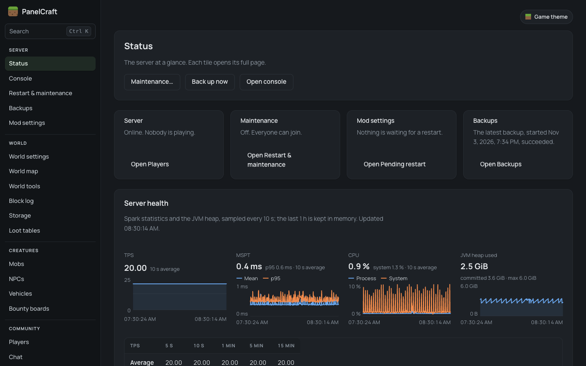 **Durum:** sunucuya tek bakışta | 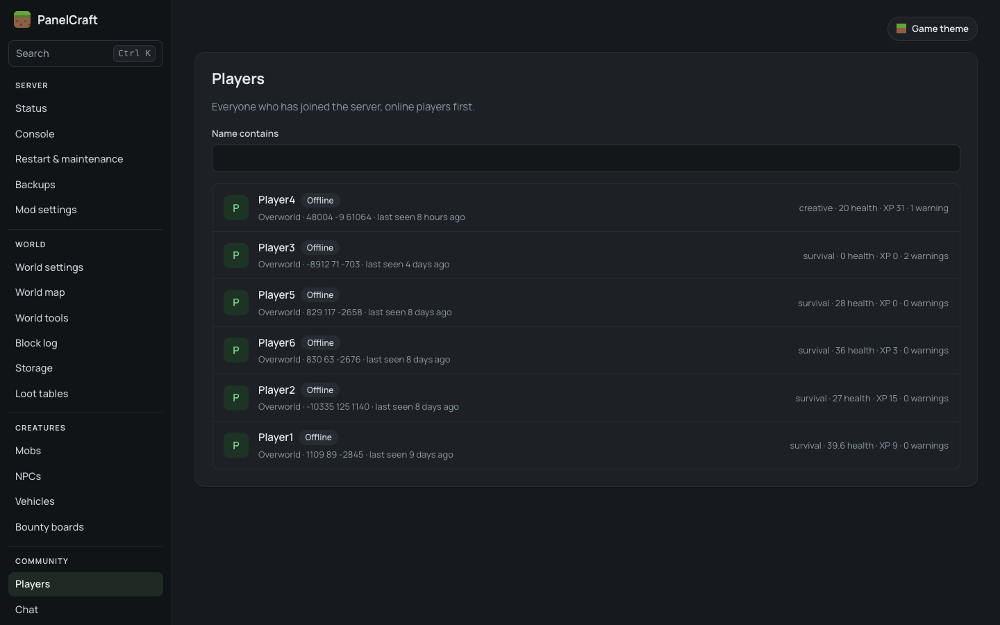 **Oyuncular:** sunucuya giren herkes |
| 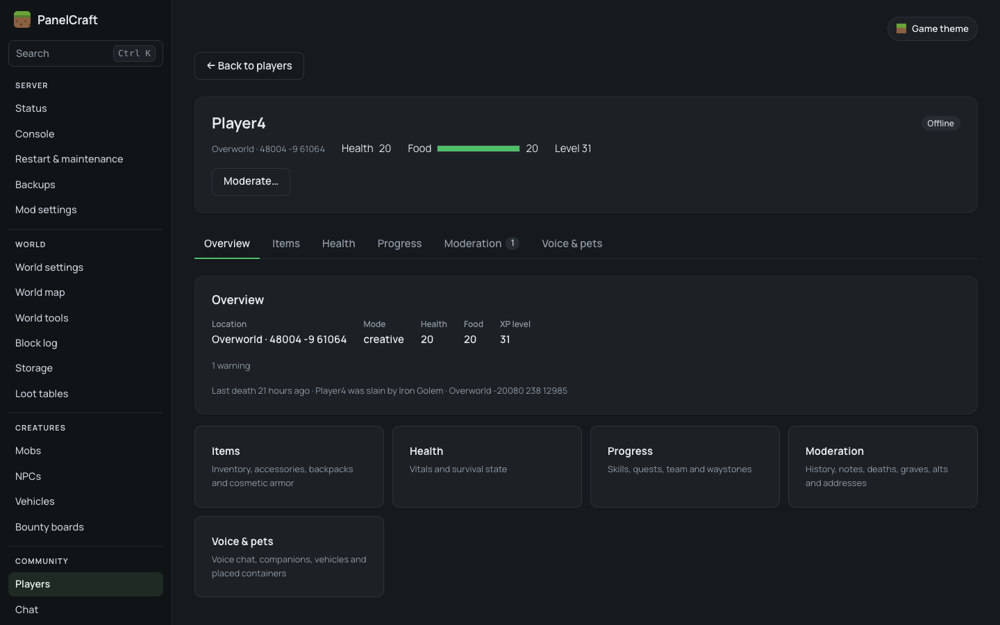 **Profil:** envanter, geçmiş, eylemler | 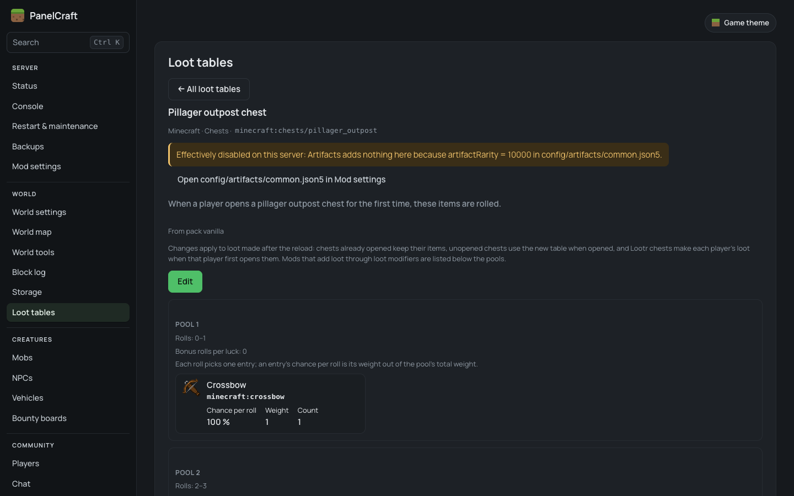 **Ganimet ayrıntısı:** eşyalar, koşullar ve modların ekledikleri |
| 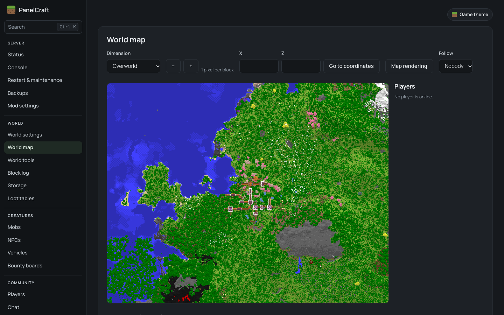 **Dünya haritası:** kayıtlı dünyadan çizilir | 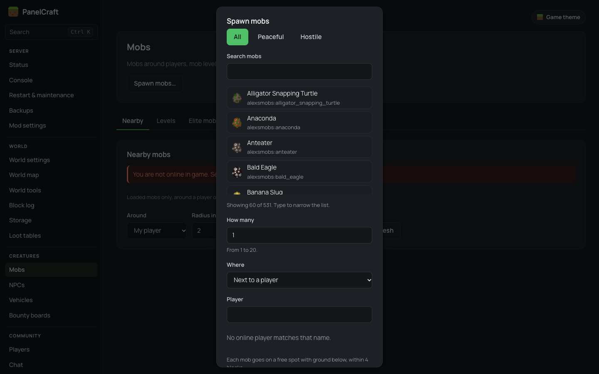 **Canlılar:** canlıları görün ve oluşturun |
| 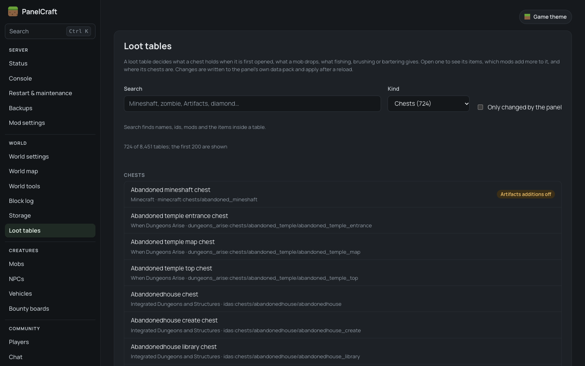 **Ganimet tabloları:** sandık ve canlı ganimetleri | 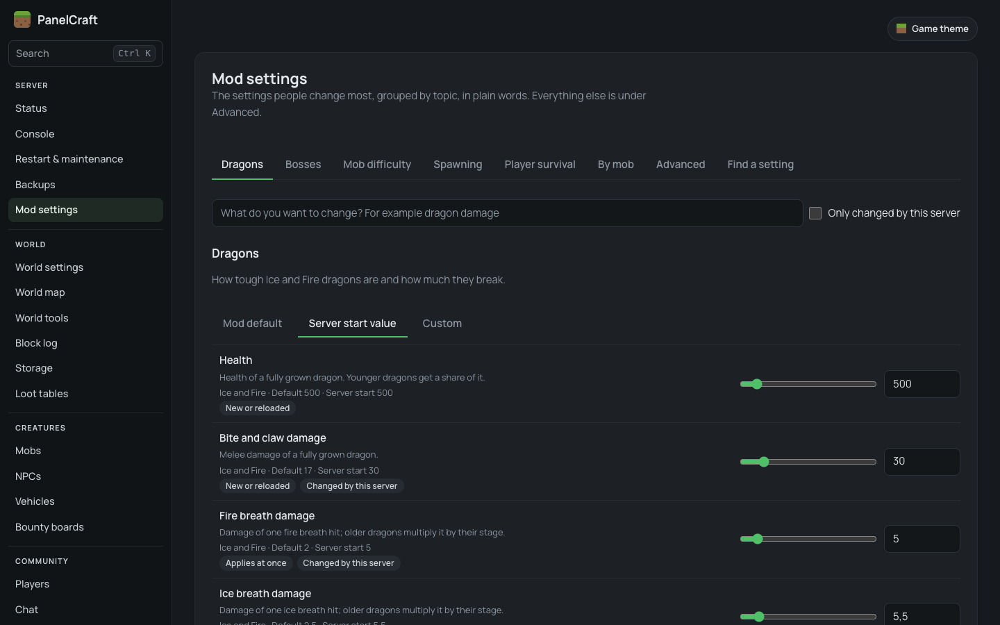 **Mod ayarları:** mod yapılandırmasını güvenle düzenleyin |
| 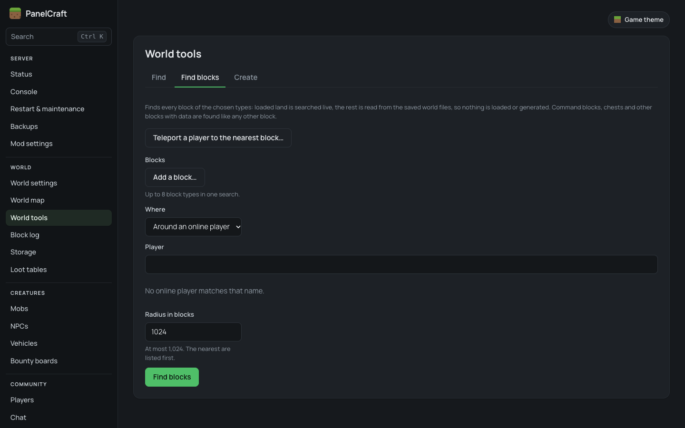 **Dünya araçları:** blok ve yapı bulun | 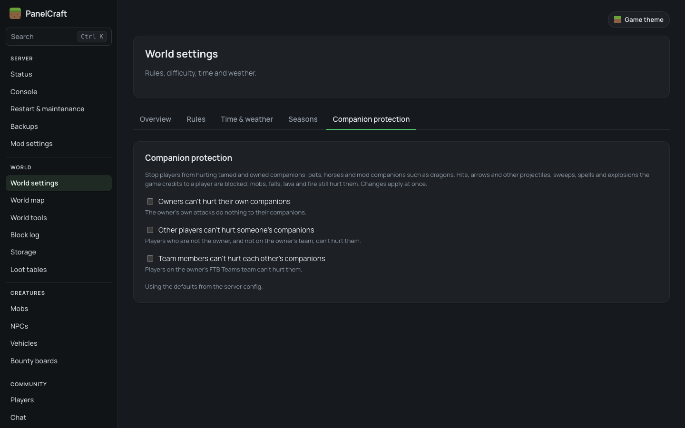 **Yoldaş koruması:** evcil hayvanları koruyun |
| 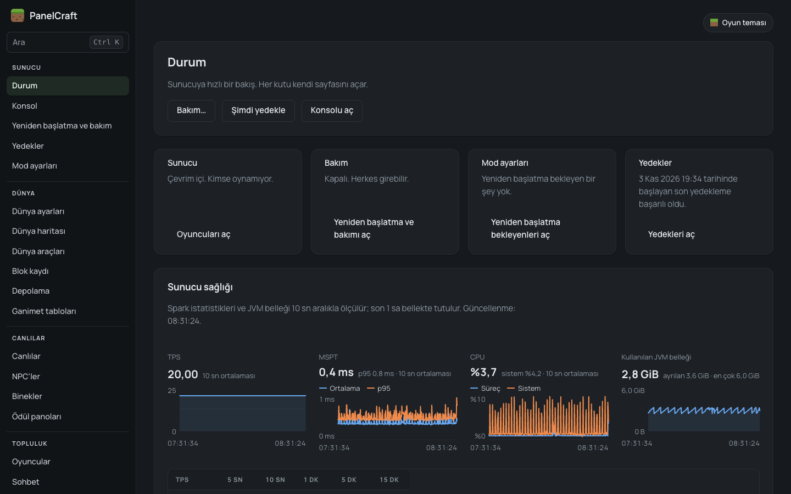 **Türkçe:** panelin tamamı Türkçe | 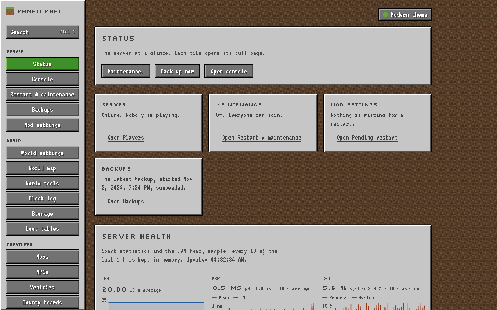 **Oyun teması:** Minecraft görünümü |

---

## Özellikler

Liste, paneldeki kenar çubuğunun sırasını izler. Ne göreceğiniz sunucu türünüze (bkz. [sunucu türüne göre özellikler](#sunucu-türüne-göre-özellikler)) ve rolünüzün izinlerine bağlıdır.

### Sunucu
- **Durum**: sunucuya tek bakışta; her kutucuk kendi sayfasını açar. [Spark](https://spark.lucko.me/) modu varsa salt okunur bir "Sunucu sağlığı" kartı eklenir (Forge 1.20.1).
- **Konsol**: canlı sunucu konsolu; izni olan roller komut da çalıştırabilir.
- **Yeniden başlatma ve bakım**: oyuncuların sohbette gördüğü bir geri sayımla (10 saniye ile 10 dakika arası) yeniden başlatma ve bakım modu (yalnızca yetkililer çevrim içi olabilir; diğerleri uyarılır, sonra atılır).
- **Yedekler**: dünyanın tamamının zip yedeği, elle ya da planlı; yedekleri indirme ve dünyayı geri yükleme (yalnızca sahip).
- **Mod ayarları**: mod yapılandırmasını tarayıcıdan değiştirin. Forge ve NeoForge'da her ayarın ne işe yaradığı ve ne kadar riskli olduğu görünür; yalnızca açılışta okunan ayarlar sonraki açılış için hazırlanır. Fabric ve Paper'da bir dosya düzenleyici vardır.
- **Modüller** (yalnızca sahip): panelin bölümlerini kapatıp açın. **Veri** (yalnızca sahip): yedekler ve denetim kaydı temizliği.

### Dünya
- **Dünya ayarları**: oyun kuralları, zorluk, zaman ve hava durumu. **Yoldaş koruması** kartı, oyuncuların evcil hayvanlara ve diğer yoldaşlara zarar vermesini engeller.
- **Dünya haritası**: kayıtlı dünya dosyalarından çizilen kuşbakışı harita (hiçbir yığını yüklemez), oyuncuların canlı konumlarıyla.
- **Dünya araçları**: yığın yüklemeden ya da oluşturmadan en yakın yapıyı, biyomu veya ilgi noktasını bulun; keşfedilmiş dünyada blok arayın; arı yuvası, oluşum veya yapı yerleştirin.
- **Blok kaydı**: kim hangi bloğu ne zaman kırdı, koydu ya da patlattı. Yedek geri yüklemeden tahribatı geri sarın, geri sarmayı da geri alın.
- **Depolama**: kim bir kabı açtı, doldurdu, boşalttı, koydu ya da kırdı; ayrıca dünyadaki kapların dizini.
- **Ganimet tabloları**: bir sandığın, canlının, balık tutmanın ya da takasın ne verdiğini görün ve değiştirin. Değişiklikler panelin kendi veri paketine yazılır ve yeniden yüklemeden sonra geçerli olur.

### Canlılar
- **Canlılar**: bir oyuncunun ya da bir noktanın çevresindeki yüklü canlılar; herhangi bir canlıyı oyuncunun yanında veya koordinatlarda oluşturma.
- **Binekler**: tekneler ve maden arabaları (ve modlu binekler), oluşturma ve sürüş kaydı. Evcil hayvanlar, atlar ve diğer yoldaşlar sahibinin profilinde görünür.
- **NPC'ler** ve **Ödül panoları**: yalnızca Easy NPC ve Bountiful modlarıyla.

### Topluluk
- **Oyuncular**: her oyuncu için bir profil: envanter, Ender sandığı, ölümler (geri yüklemeyle), eşya verme ve düzenleme, tecrübe, etkiler, özellikler ve gelişmeler, yetkili notları, ikincil hesaplar, yaptırım geçmişi. Eylemler: mesaj, ışınla, oyun modu, iyileştir, at, uyar, sustur, dondur, görünmez yap, süreli ve kalıcı yasakla.
- **Sohbet**: canlı sohbet ve aranabilir sohbet kaydı. Mod ve eklenti sunucularında özel ve takım mesajları da kaydedilir. Varsayılan olarak sunucuya giren her oyuncuya sohbetin kaydedildiği söylenir (yapılandırmadan değiştirilebilir).
- **Bildirimler**: oyuncuların oyunda `/report <oyuncu> <sebep>` ile gönderdiği bildirimler.
- **Yasaklar**: tüm yasaklar ve uyarılar tek listede.
- **Sohbet filtresi**: yasaklı kelimeler ve bunları kullanan oyunculara ne olacağı (engelle, sansürle, uyar, sustur, süreli yasakla; kademeli yaptırımla).
- **Oyun girişleri**: çevrim dışı modda ("cracked") çalışan sunucular için. Oyuncular adlarını `/register` ve `/login` ile korur; yetkililer unutulan oyun içi şifreyi sıfırlayabilir.

### Panel
- **Kullanıcılar**: yetkili hesapları, davetler, hesabı devre dışı bırakma, iki adımlı doğrulamayı sıfırlama.
- **Roller**: sıralar ve izinler; hazır **Oyuncu**, **Moderatör** ve **Yönetici** şablonlarıyla. Tehlikeli izinler işaretlidir ve onay ister. Bir rol iki adımlı girişi zorunlu tutabilir.
- **Denetim kaydı**: paneldeki her eylem, kimin ne zaman yaptığıyla.
- **Hesap**: şifreniz, iki adımlı giriş, panel dili, saat dilimi, renk düzeni (açık, koyu, otomatik) ve tema.

Panelin her yerinde **Ctrl K** ile sayfa ve eylem arayabilirsiniz. Eşya, blok ve canlı adları oyunun kendi dil dosyalarından gelir (İngilizce ve Türkçe).

### Mod entegrasyonları (yalnızca Forge 1.20.1)

**Forge 1.20.1**'de PanelCraft aşağıdaki modlar için sayfalar ve profil bölümleri ekler (Legendary Edition mod paketinin modlarına göre hazırlanmıştır). Her biri **yalnızca o mod kuruluysa** açılır. PanelCraft'ın denenmediği bir mod sürümü yine yüklenir, günlüğe bir uyarı düşer. Diğer yükleyicilerde bu entegrasyonlar henüz yok.

Legendary Survival Overhaul, Reskillable, Iron's Spells 'n Spellbooks, Curios, Backpacked, Cosmetic Armor Reworked, Feathers, Paraglider, FTB Quests, FTB Teams, Waystones, Gravestone, Simple Voice Chat, Ice and Fire, Immersive Aircraft, AstikorCarts, Serene Seasons, Lootr, Tom's Simple Storage, Bountiful, Easy NPC, AutoLeveling, Infernal Mobs, Spawn Cap Control, Spawn Balance, Harder Spawners, Spark, Map Atlases, Quality Equipment, Supplementaries, Quark, Relics, FastAsyncWorldSave, Artifacts.

### Sunucu türüne göre özellikler

| Özellik | Forge 1.20.1 | NeoForge 1.21.1 / 26.3 | Fabric 1.20.1 / 1.21.1 | Paper 1.21.1 / 26.3 | Vanilla (ayrı program) |
|---|---|---|---|---|---|
| Oyuncular, envanterler, oyuncu durumu, eşya verme | evet | evet | evet | evet | çevrim içi oyuncular RCON ile; çevrim dışı oyuncular salt okunur; eşya düzenleme yok |
| Yasaklar, uyarılar, ikincil hesaplar | evet | evet | evet | evet | evet |
| Susturma, dondurma, görünmezlik, bildirimler, oyun içi giriş | evet | evet | evet | evet | hayır |
| Canlı sohbet, konsol, sohbet kaydı | evet | evet | evet | evet | sunucu günlüğünden (özel mesajlar yok) |
| Sohbet filtresi | engeller ve sansürler | engeller ve sansürler | engeller ve sansürler | engeller ve sansürler | mesajdan sonra işler (engelleyemez) |
| Dünya ayarları, yeniden başlatma, bakım | evet | evet | evet | evet | evet |
| Dünya araçları, canlılar, dünya haritası | evet | evet | evet | evet | hayır |
| Blok kaydı, depolama | evet | evet | evet | evet (vanilla kaplar) | hayır |
| Yoldaşlar, ganimet tabloları | evet | evet | evet (ganimet değiştiricileri yok) | evet (ganimet değiştiricileri yok) | hayır |
| Mod ayarları | ayar ayar düzenleyici | ayar ayar düzenleyici | dosya düzenleyici | dosya düzenleyici | hayır |
| Yedekler, dünya geri yükleme | evet | evet | evet | evet | yedek; geri yükleme elle değiştireceğiniz bir kopya hazırlar |
| Mod entegrasyonları (yukarıdaki liste) | evet | hayır | hayır | hayır | hayır |

Fabric'in blok kaydı kovaları, ateşi ve yatak ile kapıların ikinci yarısını kaydetmez. NeoForge 26.3 ve Paper 26.3'te çevrim içi oyunculara dokunan özellikler henüz gerçek bir 26.3 oyun istemcisiyle denenmedi.

---

## Hangi dosyayı indirmeliyim?

**[Son sürüm](https://github.com/panelcraft/panelcraft/releases/latest)** sayfasına gidin ve sunucunuza uyan **tek bir** dosyayı indirin:

| Sunucunuz | Minecraft sürümü | İndirilecek dosya | Nereye konur |
|---|---|---|---|
| Forge (47.x) | 1.20.1 | `panelcraft-forge-1.20.1-0.1.0.jar` | `mods/` |
| NeoForge (21.1.x) | 1.21.1 | `panelcraft-neoforge-1.21.1-0.1.0.jar` | `mods/` |
| NeoForge (26.3.x) | 26.3 | `panelcraft-neoforge-26.3-0.1.0.jar` | `mods/` |
| Fabric (Loader 0.20.1 ya da yenisi + Fabric API) | 1.20.1 | `panelcraft-fabric-1.20.1-0.1.0.jar` | `mods/` |
| Fabric (Loader 0.20.1 ya da yenisi + Fabric API) | 1.21.1 | `panelcraft-fabric-1.21.1-0.1.0.jar` | `mods/` |
| Paper | 1.21.1 | `panelcraft-paper-1.21.1-0.1.0.jar` | `plugins/` |
| Paper | 26.3 | `panelcraft-paper-26.3-0.1.0.jar` | `plugins/` |
| Vanilla (modsuz) | 1.20.1–1.20.6, 1.21–1.21.11, 26.1–26.3 | `panelcraft-standalone-0.1.0.jar` | kendi klasörü (ayrı çalışır) |

- Her mod ve eklenti dosyası yalnızca o Minecraft sürümünde çalışır.
- Spigot ve Bukkit, Paper dosyalarını yükleyemez. Folia desteklenmiyor.
- PanelCraft yalnızca sunucuya kurulur. **Oyuncular hiçbir şey kurmaz.**
- Sürüm sayfasındaki `SHA256SUMS.txt` ile indirdiğiniz dosyanın eksiksiz olduğunu kontrol edebilirsiniz.

Minecraft sürümünüzü oyundaki sunucu listesinde ve sunucu konsolunun ilk satırlarında görebilirsiniz.

---

## Gereksinimler

| | |
|---|---|
| **Java** | Forge 1.20.1, Fabric 1.20.1 ve ayrı program: **Java 17** ya da yenisi. NeoForge 1.21.1, Fabric 1.21.1 ve Paper 1.21.1: **Java 21**. NeoForge 26.3 ve Paper 26.3: **Java 25**. Mod ve eklenti, sunucunun zaten kullandığı Java ile çalışır; o Minecraft sürümü de bunu ister. |
| **İşletim sistemi** | Linux (x64, arm64), Windows (x64) ya da macOS (x64, Apple Silicon). Yerleşik veritabanı başka sistemlerde çalışmaz. |
| **Bellek** | PanelCraft sunucunun Java sürecinin içinde çalışır ve belleğinin bir kısmını kullanır. Harita ve blok arama çalışırken daha fazlasını kullanır. Sunucunuzun bugün ihtiyaç duyduğunun üstünde biraz pay bırakın. |
| **İnternet (sunucu tarafı)** | Önerilir. Sunucu, eşya simgeleri ve Türkçe oyun adları için resmi Minecraft istemci dosyalarını Mojang'dan bir kez indirir; çevrim içi modda oyuncu adlarını Mojang'da doğrular ve oyuncu görünümlerini indirir. İnternet yoksa panel çalışır, ama vanilla eşyalar simge yerine yazıyla görünür ve oyun adları İngilizce kalır. |
| **Portlar** | Panel **8150** portunu kullanır. Varsayılan olarak yalnızca sunucu makinesinin kendisine yanıt verir. Başka bilgisayarlardan erişilebilir yapmadan önce [Paneli güvenceye almak](#paneli-güvenceye-almak) bölümünü okuyun. Oyun portunuz (genelde 25565) değişmez. |
| **Yalnızca vanilla** | `server.properties` içinde RCON açık olmalı ve PanelCraft, sunucunun dosyalarını okuduğu için Minecraft sunucusuyla **aynı makinede** çalışmalı. |

---

## Kurulum

Başlamadan önce **sunucunuzu durdurun** ve **dünya klasörünüzün yedeğini alın**.

Kurulum her sunucu türünde hemen hemen aynıdır. Sunucunuza uyanı açın.

<details>
<summary><b>Forge, NeoForge ya da Fabric (mod)</b></summary>

1. Sunucuyu durdurun.
2. [Tablodan](#hangi-dosyayı-indirmeliyim) uyan dosyayı indirin.
3. **Yalnızca Fabric:** [Fabric API](https://modrinth.com/mod/fabric-api) da `mods/` klasöründe olmalı. PanelCraft onsuz yüklenmez.
4. PanelCraft `.jar` dosyasını sunucunun `mods/` klasörüne kopyalayın.
5. Sunucuyu başlatın.
6. Konsolu izleyin. Sunucu açıldığında şu iki satırı görmelisiniz:
   ```
   PanelCraft setup code written to config/panelcraft/one-time-code.txt
   PanelCraft listening on port 8150
   ```
7. PanelCraft şunları oluşturdu:
   - `config/panelcraft.toml`: ayar dosyası,
   - `config/panelcraft/`: panelin veri klasörü (veritabanı, tek kullanımlık kod, önbellekler).
8. [Paneli sahiplenin (ilk açılış)](#paneli-sahiplenin-ilk-açılış) bölümüyle devam edin.

</details>

<details>
<summary><b>Paper (eklenti)</b></summary>

1. Sunucuyu durdurun.
2. [Tablodan](#hangi-dosyayı-indirmeliyim) uyan dosyayı indirin.
3. PanelCraft `.jar` dosyasını sunucunun `plugins/` klasörüne kopyalayın.
4. Sunucuyu başlatın.
5. Konsolu izleyin. Sunucu açıldığında şu iki satırı görmelisiniz:
   ```
   PanelCraft setup code written to plugins/PanelCraft/one-time-code.txt
   PanelCraft listening on port 8150
   ```
6. PanelCraft şunları oluşturdu:
   - `config/panelcraft.toml`: ayar dosyası. Paper'da da sunucunun `config/` klasöründe, Paper'ın kendi dosyalarının yanında durur; `plugins/PanelCraft/` içinde **değil**.
   - `plugins/PanelCraft/`: panelin veri klasörü (veritabanı, tek kullanımlık kod, önbellekler).
7. [Paneli sahiplenin (ilk açılış)](#paneli-sahiplenin-ilk-açılış) bölümüyle devam edin.

</details>

<details>
<summary><b>Vanilla sunucu (ayrı program)</b></summary>

Vanilla sunucuda Minecraft'a hiçbir şey kurulmaz. PanelCraft aynı makinede kendi programı olarak çalışır, sunucunun dosyalarını okur ve komutları RCON ile gönderir.

**1. RCON'u açın.** Minecraft sunucusunu durdurun, `server.properties` dosyasını açın ve şunları ayarlayın:

```properties
enable-rcon=true
rcon.port=25575
rcon.password=BURAYA-UZUN-RASTGELE-BIR-SIFRE-YAZIN
```

Minecraft sunucusunu yeniden başlatın. PanelCraft bu değerleri kendisi okur, `server.properties` dosyasını asla değiştirmez. **25575 portunu güvenlik duvarında ya da modemde açmayın**: onu yalnızca aynı makinedeki PanelCraft kullanır.

**2. PanelCraft için bir klasör açın**; Minecraft sunucu klasörünün içine değil, yanına. Örneğin:

```
/srv/minecraft     ← Minecraft sunucunuz (server.properties burada)
/srv/panelcraft    ← PanelCraft için yeni, boş klasör
```

**3.** `panelcraft-standalone-0.1.0.jar` dosyasını yeni klasöre koyun.

**4. Bir kez başlatın**, o klasörün içinden:

```
java -jar panelcraft-standalone-0.1.0.jar
```

`config/panelcraft.toml` dosyasını oluşturur ve `server.properties` bulamadığını söyleyerek kapanır. Bu beklenen bir durum.

**5. Sunucunuzu gösterin.** `config/panelcraft.toml` dosyasını açın ve `[standalone]` altındaki `server_dir` değerini Minecraft sunucu klasörü yapın:

```toml
[standalone]
server_dir = "/srv/minecraft"
secret_output = "file"
```

Windows'ta düz eğik çizgi ya da çift ters eğik çizgi kullanın, örneğin `server_dir = "C:/minecraft"`.

**6. Yeniden başlatın**, aynı şekilde. Şunu görmelisiniz:

```
PanelCraft setup code written to config/panelcraft/one-time-code.txt
PanelCraft 0.1.0 listening on http://127.0.0.1:8150
```

RCON kapalıysa ya da şifresi yoksa PanelCraft kapanır ve `server.properties` dosyasına eklenecek satırları olduğu gibi yazar. Minecraft sunucusu durur ya da yeniden başlarsa PanelCraft çalışmaya devam eder ve 5 saniyede bir yeniden bağlanır.

**7. Açık tutun.** PanelCraft'ı durdurmak için kendi konsoluna `stop` (ya da `panelcraft stop`) yazın veya Ctrl+C'ye basın. Linux'ta otomatik başlaması için systemd kullanabilirsiniz:

```ini
[Unit]
Description=PanelCraft
After=network.target minecraft.service

[Service]
User=minecraft
WorkingDirectory=/srv/panelcraft
ExecStart=/usr/bin/java -jar panelcraft-standalone-0.1.0.jar
Restart=on-failure
RestartSec=5

[Install]
WantedBy=multi-user.target
```

**Vanilla'da bilmeniz gerekenler:**
- PanelCraft ilk açılışta küçük bir veri paketi ekler (`<dünya>/datapacks/panelcraft/`) ve veri paketlerini yeniden yükler. `/trigger panelcraft set <kod>` (karakter bağlama) için gereklidir.
- Minecraft hesabı bağlama yalnızca `online-mode=true` iken çalışır. Çevrim dışı moddaki vanilla sunucuda herkes istediği adla girebilir; bu yüzden panel hesaplarını PanelCraft konsolunda `panelcraft adduser <ad>` ile oluşturursunuz (bkz. [Moderatör eklemek](#moderatör-eklemek)).
- Vanilla'da oyun içi `/login` koruması yoktur.
- Veri klasörü, PanelCraft klasörünün içindeki `config/panelcraft/` klasörüdür.

[Paneli sahiplenin (ilk açılış)](#paneli-sahiplenin-ilk-açılış) bölümüyle devam edin.

</details>

<details>
<summary><b>Barındırma panelleri: PufferPanel, Pterodactyl ve benzerleri</b></summary>

Barındırma panelleri aynı sunucu klasörünü **Dosya Yöneticisi**'nde gösterir. Yukarıdaki her adım için onu kullanın.

**Mod ya da eklenti sunucusu**

1. Barındırma panelinden sunucuyu durdurun.
2. Dosya Yöneticisi'nde `mods/` (Forge, NeoForge, Fabric) ya da `plugins/` (Paper) klasörünü açın ve PanelCraft `.jar` dosyasını yükleyin.
3. Sunucuyu başlatın ve barındırma panelinin **Konsol**'unda `PanelCraft listening on port 8150` satırını bekleyin.
4. Tek kullanımlık kod dosyasını Dosya Yöneticisi'nde açın: `config/panelcraft/one-time-code.txt` (Paper'da `plugins/PanelCraft/one-time-code.txt`).
5. **Panele ulaşmak.** Panelin kendi ağ portuna ihtiyacı vardır ve varsayılan olarak yalnızca makinenin kendisini dinler.
   - **Pterodactyl**'de (ve onun üzerine kurulu hizmetlerde) her sunucu kendi kapsayıcısında çalışır. Sunucuya ikinci bir port ekleyin (barındırıcınız izin veriyorsa **Network** sekmesinden), sonra `config/panelcraft.toml` içinde şunu ayarlayın:
     ```toml
     [web]
     bind = "0.0.0.0"
     port = 25580        # barındırıcınızın verdiği ek port
     ```
   - **PufferPanel**'de sunucular doğrudan makinede çalışır. Boş bir port seçin, makinenin güvenlik duvarında açın ve `bind`/`port` değerlerini aynı şekilde ayarlayın.
   - Sunucuyu yeniden başlatın, ardından tarayıcıda `http://<sunucu adresi>:<port>` adresini açın.
   - **Önce [Paneli güvenceye almak](#paneli-güvenceye-almak) bölümünü okuyun.** HTTPS olmadan şifreler internette şifrelenmeden gider. Barındırıcınız HTTPS'li bir alan adı ya da ters vekil sunuyorsa onu kullanın.
6. **Yeniden başlatmalar.** PanelCraft, yeniden başlatma ya da dünya geri yükleme için sunucuyu yalnızca *durdurabilir*; yeniden açmak barındırma panelinin işidir. Bkz. [`[restart] supervised` ayarı](#yeniden-başlatma-ve-supervised-ayarı).
7. `panelcraft reset <ad>` gibi komutlar için barındırma panelinin konsolu, sunucu konsolu yerine geçer.

**PufferPanel'de vanilla (ayrı program)**

PanelCraft'ı Minecraft sunucusunun içine değil, yanına **ayrı bir sunucu kaydı** olarak ekleyin. Ona kendi klasörünü ve `java -jar panelcraft-standalone-0.1.0.jar` başlatma komutunu verin; kendi `config/panelcraft.toml` dosyasında `server_dir` değerini Minecraft sunucusunun klasörü yapın. `stop` ile (PufferPanel'in varsayılan durdurma komutu) durdurmak temiz bir kapanıştır; temiz kapanışı atlayan **Kill**'i kullanmayın.

Pterodactyl'de her sunucunun kendine ait yalıtılmış bir kapsayıcısı vardır; bu yüzden ayrı bir PanelCraft programı genellikle Minecraft sunucusunun dosyalarını okuyamaz. Bunun yerine Paper ya da Fabric sunucusu ve eklenti veya mod sürümünü kullanın.

</details>

### Paneli tarayıcıda açmak

- **Sunucu makinesinin kendisinde:** <http://127.0.0.1:8150> adresini açın.
- **Kendi bilgisayarınızdan, sunucu başka yerdeyse (en güvenli hızlı yol):** SSH tüneli kullanın. Bilgisayarınızda bir terminalde
  `ssh -L 8150:127.0.0.1:8150 kullaniciadi@sunucunuz`
  komutunu çalıştırın; açık kaldığı sürece bilgisayarınızda <http://127.0.0.1:8150> adresine gidin.
- **Kalıcı olarak, tüm yetkililer için:** paneli HTTPS arkasına alın. Bkz. [Paneli güvenceye almak](#paneli-güvenceye-almak).

### Yeniden başlatma ve `supervised` ayarı

PanelCraft, yeniden başlatma ya da dünya geri yükleme için sunucuyu **yalnızca durdurur**. Onu yeniden açacak başka bir şey olmalı: PufferPanel, Pterodactyl, systemd ya da başlatma betiğindeki bir döngü. Siz bunu onaylayana kadar panel her yeniden başlatmadan önce sunucunun kapalı kalacağı uyarısını gösterir.

Sunucunuz durduktan sonra kendiliğinden geri açılıyorsa `config/panelcraft.toml` dosyasını açın ve şunu ayarlayın:

```toml
[restart]
supervised = true
```

Denemek için: **Yeniden başlatma ve bakım** sayfasında kısa bir geri sayımla yeniden başlatma başlatın ve sunucunun kendiliğinden açıldığını kontrol edin. Ayarın okunması için sunucuyu sonra bir kez daha yeniden başlatın.

---

## Paneli sahiplenin (ilk açılış)

Tek kullanımlık kurulum kodunu ilk giren kişi panelin **sahibi** olur. Sahip her şeyi yapabilir ve diğer yetkililer onu dışarıda bırakamaz.

### 1. Kurulum kodunu bulun

Kod dosyasını açın. Yeri:

| Sunucu türü | Kod dosyası |
|---|---|
| Forge, NeoForge, Fabric | `config/panelcraft/one-time-code.txt` |
| Paper | `plugins/PanelCraft/one-time-code.txt` |
| Vanilla (ayrı program) | PanelCraft'ın kendi klasöründe `config/panelcraft/one-time-code.txt` |

Dosyada şuna benzer tek bir satır vardır:

```
SETUP_OWNER - ABCDEF123456 valid until never
```

Kod, `-` ile `valid` arasındaki kısımdır (burada `ABCDEF123456`). Bir kez çalışır ve süresi dolmaz; ama bir sahip olana kadar sunucu her açıldığında yeni bir kod eskisinin yerini alır. Kurulumdan sonra dosya silinir.

> Vanilla'da `[standalone]` altında `secret_output = "console"` ayarlarsanız kodlar dosya yerine PanelCraft konsoluna yazılır.

### 2. Sahip hesabını oluşturun

1. Paneli tarayıcıda açın. **Bu sunucuyu sahiplenin** sayfasını göreceksiniz.
2. **Kurulum kodu**'nu girin.
3. **Minecraft oyuncu adı**'nızı oyunda nasılsa tam öyle girin. Çevrim içi modda Mojang'da doğrulanır.
4. Bir şifre seçin: **en az 10 karakter**. Tekrar yazın.
5. **Sahip hesabını oluştur**'a tıklayın.

Panel hesabınız artık bu Minecraft karakterine bağlı. Ayrıca bağlama yapmanız gerekmez.

### 3. İki adımlı doğrulamayı açın

Sahip için iki adımlı giriş zorunludur; panel bunu hemen ister (**İki adımlı doğrulamayı kurun**):

1. Telefonunuza bir doğrulama uygulaması kurun, örneğin Aegis, 2FAS ya da Google Authenticator.
2. QR kodunu uygulamayla tarayın (ya da altındaki anahtarı elle girin).
3. Uygulamanın gösterdiği 6 haneli kodu girin ve **İki adımlı doğrulamayı aç**'a tıklayın.

Bundan sonra giriş yaparken oyuncu adınız, şifreniz ve o anki 6 haneli kod istenir. Yedek kod yoktur. Telefonunuzu kaybederseniz bkz. [Şifremi unuttum ya da telefonumu kaybettim](#sifremi-unuttum).

Diğer yetkililer iki adımlı doğrulamayı **Hesap → İki adımlı giriş → İki adımlı doğrulamayı aç…** ile açabilir. Bir rol bunu zorunlu tutabilir (Yönetici şablonu tutar).

---

## Moderatör eklemek

Her yetkilinin kendi Minecraft karakterine bağlı bir panel hesabı ve ne yapabileceğini belirleyen bir **rolü** olur.

### 1. Şablondan bir rol oluşturun

1. **Panel → Roller**'e gidin ve **Şablondan yeni rol…**'e tıklayın.
2. Bir şablon seçip **Kullan**'a tıklayın. Form dolar; henüz hiçbir şey kaydedilmez.
3. Kontrol edin ve **Rolü oluştur**'a tıklayın. Tehlikeli izinler bir onay kutusu ve şifrenizi ister.

| Şablon | Sıra | İki adımlı doğrulama | Neler yapabilir |
|---|---|---|---|
| **Oyuncu** | 10 | hayır | Panelde hiçbir şey. Yalnızca giriş yapıp kendi hesabını yönetebilir. |
| **Moderatör** | 100 | hayır | Oyuncuları ve sohbeti izler, bildirimlerle ilgilenir; uyarır, susturur, dondurur, atar, süreli yasaklar, görünmez olur, duyuru yapar; envanter, depolama, blok kaydı ve mod verilerini salt okunur görür. Kalıcı yasak, ışınlama, dünya değişikliği ve konsol yok. |
| **Yönetici** | 500 | zorunlu | Konsol komutları ve yedek silme dışında her şey. Dünya geri yükleme, modüller, veri, yeniden başlatma ve sahipliği devretme her zaman sahipte kalır. |

Rolün **sırası** önemlidir: yetkililer yalnızca kendi sıralarının **altındaki** kullanıcıları ve rolleri yönetebilir.

### 2. Kişiyi ekleyin

Kişinin sunucuya en az bir kez girmiş olması gerekir.

1. **Panel → Kullanıcılar**'a gidin, **Kullanıcı ekle…**'ye tıklayın, oyuncuyu ve rolü seçin.
2. Kişiye kalanını kendisinin yapmasını söyleyin:
   1. Panelin giriş sayfasında **İlk kez mi geliyorsunuz? Karakterinizi bağlayın** seçeneğini seçer.
   2. Oyuncu adını girer ve **Kod al**'a tıklar.
   3. Sunucuya girer ve oyunda yazar:
      - mod ya da eklenti sunucusunda: `/panelcraft link <kod>`
      - vanilla sunucuda: `/trigger panelcraft set <kod>`
   4. Bir panel şifresi seçer. Rol hemen uygulanır.

Davet 72 saat geçerlidir (`[users] invite_hours`). Bir oyuncu davetsiz de bağlanabilir; o zaman siz Kullanıcılar sayfasında **Rolü değiştir…** ile rol verene kadar **Rol bekleniyor** ekranını görür.

**Çevrim dışı moddaki vanilla sunucular:** bağlama kullanılamaz. PanelCraft konsolunda `panelcraft adduser <ad>` çalıştırın. Tek kullanımlık bir kod yazar (kod dosyasına, 30 dakika geçerli); oyuncu giriş sayfasında **Sıfırlama kodu kullan**'ı seçer, kodu girer ve şifresini belirler. Sonra Kullanıcılar sayfasından ona bir rol verin.

**Çevrim dışı moddaki mod/eklenti sunucuları:** oyun içi giriş açıkken (varsayılan, aşağıya bakın) bağlama yukarıdaki gibi çalışır, çünkü oyuncular adlarını `/login` ile kanıtlamıştır.

### Çevrim dışı sunucularda oyun içi giriş

Çevrim dışı modda herkes istediği adla girebilir. Varsayılan `[game_login] mode = "auto"` ile PanelCraft, çevrim dışı modda çalışan mod ve eklenti sunucularında adları korur:

- Yeni oyuncular `/register <şifre> <şifre>`, dönen oyuncular `/login <şifre>` yazar (en az 6 karakter); girişten sonraki 60 saniye içinde.
- O zamana kadar donmuş kalırlar; sohbet edemez, komut kullanamaz, blok kıramaz ya da koyamaz, envanterlerine dokunamazlar.
- Unutulan oyun içi şifre: **Topluluk → Oyun girişleri** tek kullanımlık bir kod verir; oyuncu yeniden girip `/register <kod> <şifre> <şifre>` yazar.

`mode = "on"` her zaman zorunlu tutar, `mode = "off"` hiçbir zaman. Çevrim içi sunucularda `auto` bunu kapalı bırakır, çünkü kimin kim olduğunu Mojang zaten doğrular. `online-mode` ya da bu ayar değişince sunucuyu yeniden başlatın.

---

## Dili değiştirmek

Panel **İngilizce** ve **Türkçe** konuşur.

- Herkes kendisi seçer: **Hesap → Dil → Panel dili**. Seçim yoksa panel tarayıcının dilini izler.
- Eşya, blok ve canlı adları oyunun ve modların kendi dil dosyalarından gelir. Vanilla'nın Türkçe adları Mojang'dan bir kez indirilir (bunun için `[assets]` altında `download_client_jar = true` olmalı, varsayılan budur; sunucuda internet de gerekir). Türkçe dosyası olmayan bir mod adlarını İngilizce gösterir.
- Oyuncuların oyunda gördüğü mesajlar (girişte sohbet kaydı bildirimi, bakım uyarıları, yedek duyuruları vb.) `config/panelcraft.toml` içinde ayarlanır ve varsayılanları İngilizcedir. Türkçe isterseniz oradan değiştirin.

---

## Paneli güvenceye almak

Panel oyuncu yasaklayabilir, envanter düzenleyebilir ve bazı roller için konsol komutu çalıştırabilir. Ona sunucunuzun yönetici şifresi gibi davranın.

**Kurallar:**

1. **8150 portunu internete düz `http://` ile açmayın.** Şifreler ve oturum çerezleri şifrelenmeden gider. Varsayılan olarak panel yalnızca `127.0.0.1` adresini (makinenin kendisi) dinler; bu güvenlidir.
2. Başka bilgisayarlardan erişim için paneli bir ters vekil (aşağıda) ile **HTTPS** arkasına alın ya da SSH tüneli kullanın.
3. `bind = "0.0.0.0"` yapmak, güvendiğiniz bir ev ağında ya da barındırıcınız başka yol bırakmadığında olabilir. O zaman herkes için güçlü şifre ve iki adımlı doğrulama kullanın.
4. **RCON portunu asla açmayın** (vanilla, genelde 25575).
5. Operatör (op) yetkisini yalnızca panel hesabı vermeye güvendiğiniz kişilere verin. Vanilla'da bir operatör, skor tablosu komutuyla başkasının bağlama isteğini onaylayabilir.
6. `server.properties` içindeki `function-permission-level` değerini varsayılanında (2) bırakın. 4 olduğunda veri paketi fonksiyonları konsol yetkisiyle çalışır ve panel şifre sıfırlama kodu üretebilir.

### HTTPS ile ters vekil

Paneli `127.0.0.1:8150` üzerinde bırakın ve HTTPS işini aynı makinedeki bir web sunucusuna verin. PanelCraft'ın varsayılanları buna zaten uygundur:

```toml
[web]
bind = "127.0.0.1"
port = 8150

[security]
trusted_proxies = ["127.0.0.1", "::1"]
secure_cookies = "auto"
```

- `trusted_proxies`, PanelCraft'ın `X-Forwarded-For` ve `X-Forwarded-Proto` başlıklarına güvendiği adresleri listeler. Tek tek adres yazın (`/24` gibi aralık değil). Vekiliniz başka bir makinedeyse ya da panele bir Docker ağı üzerinden ulaşıyorsa o adresi aynen ekleyin. Geçersiz bir girdi panelin açılmasını engeller.
- `secure_cookies = "auto"`, istek HTTPS ile geldiğinde (doğrudan ya da `X-Forwarded-Proto: https` gönderen güvenilir bir vekilden) giriş çerezini yalnızca HTTPS'e özel işaretler. `"always"` ve `"never"` bunu zorlar. `auto` olarak bırakın.
- Vekil **asıl `Host` başlığını iletmeli** ve **WebSocket**'e izin vermelidir; yoksa canlı Sohbet ve Konsol sayfaları reddedilir.

**Caddy** (HTTPS sertifikasını kendisi alır; alan adını kendinizinkiyle değiştirin):

```
panel.example.com {
    reverse_proxy 127.0.0.1:8150
}
```

**nginx** (elinizde olan bir sertifikayla, örneğin Let's Encrypt / certbot):

```nginx
server {
    listen 443 ssl;
    server_name panel.example.com;

    ssl_certificate     /etc/letsencrypt/live/panel.example.com/fullchain.pem;
    ssl_certificate_key /etc/letsencrypt/live/panel.example.com/privkey.pem;

    location / {
        proxy_pass http://127.0.0.1:8150;
        proxy_http_version 1.1;
        proxy_set_header Host $host;
        proxy_set_header X-Forwarded-For $proxy_add_x_forwarded_for;
        proxy_set_header X-Forwarded-Proto $scheme;
        proxy_set_header Upgrade $http_upgrade;
        proxy_set_header Connection "upgrade";
    }
}
```

### Güvenlik duvarı temelleri

| Port | Ne | İnternete açık mı? |
|---|---|---|
| 25565 (ya da sizinki) | Minecraft oyunu | Evet, eskisi gibi |
| 443 (sertifika için 80) | Ters vekiliniz (HTTPS) | Evet, kullanıyorsanız |
| 8150 | PanelCraft panelinin kendisi | **Hayır** (yalnızca önünde HTTPS varsa ya da güvenilir yerel ağda) |
| 25575 | RCON (vanilla) | **Asla** |

Ubuntu'da `ufw` ile, ters vekil kullanırken örnek: `sudo ufw allow 25565/tcp`, `sudo ufw allow 80/tcp`, `sudo ufw allow 443/tcp`; 8150 ve 25575'i eklemeyin.

---

## Güncelleme

1. Sunucunuza uyan yeni dosyayı [son sürüm](https://github.com/panelcraft/panelcraft/releases/latest) sayfasından indirin.
2. Sunucuyu durdurun (vanilla'da PanelCraft'ı da durdurun).
3. İsteğe bağlı ama akıllıca: panelin veri klasörünü (`config/panelcraft/`, Paper'da `plugins/PanelCraft/`) güvenli bir yere kopyalayın.
4. **Eski PanelCraft jar dosyasını silin** ve yenisini yerine koyun. `mods/` ya da `plugins/` içinde aynı anda iki PanelCraft jar'ı çalışmaz.
5. Sunucuyu başlatın. Veritabanı kendiliğinden yükseltilir.

`config/panelcraft.toml` dosyanız korunur. Yeni bir sürümün eklediği yeni ayarlar, siz dosyaya ekleyene kadar varsayılan değerleriyle çalışır.

---

## Yedekler ve geri yükleme

**Yedekler** (Sunucu → Yedekler), oyun sürerken alınan, dünya klasörünün tamamını içeren zip dosyalarıdır.

- Sayfadaki **Şimdi yedekle**'ye tıklayın. Planlı yedekler varsayılan olarak kapalıdır. `config/panelcraft.toml` içinden açın:
  ```toml
  [backups]
  directory = "backups"     # zip dosyalarının gideceği yer
  interval_minutes = 360    # 0 = planlı yedek yok
  keep_count = 7            # en yeni 7 yedeği tut
  ```
- `directory` sunucu klasörüne (vanilla'da PanelCraft'ın klasörüne) göredir ve dünya klasörünün içinde olamaz.
- Yedek yalnızca dünya boyutu artı 1 GB boş disk alanı varsa başlar.
- Yedekler sayfadan indirilebilir (uygun izinle).

Dünya **geri yükleme** yalnızca sahibe açıktır.

- **Mod ve eklenti sunucuları:** bakım modu açılır ve oyuncuları bir geri sayımla uyarır, sunucu yeniden başlar ve dünya klasörü, dünya yüklenmeden önce değiştirilir. Mevcut dünyanız yanında `<dünya>.before-restore-<zaman>` olarak saklanır ve geri yükleme geri alınabilir. Bunun için sunucunun durduktan sonra geri açılması gerekir: bkz. [`supervised`](#yeniden-başlatma-ve-supervised-ayarı).
- **Vanilla:** yedek, dünyanın yanına yeni bir klasör olarak açılır. Sayfa, sunucu kapalıyken klasörleri sizin değiştirmeniz için adımları gösterir. Sunucu yeniden açıldığında PanelCraft değişikliği fark eder.

Panelin kendisini yedeklemek için sunucu kapalıyken veri klasörünü (`config/panelcraft/` ya da `plugins/PanelCraft/`) ve `config/panelcraft.toml` dosyasını kopyalayın.

---

## Kaldırma

1. Sunucuyu durdurun.
2. PanelCraft jar dosyasını `mods/` ya da `plugins/` klasöründen silin (vanilla: PanelCraft'ı durdurup klasörünü silin).
3. Şunlar geride kalır. Gerekmiyorsa silin:

| Ne | Nerede |
|---|---|
| Ayarlar | `config/panelcraft.toml` |
| Panel verisi: hesaplar, kayıtlar, önbellekler (şifre özetlerini içerir) | `config/panelcraft/` (Paper: `plugins/PanelCraft/`) |
| Dünya yedekleri | `backups/` (ya da ayarladığınız klasör) |
| Ganimet ya da canlı seviyesi düzenlediyseniz panelin veri paketleri | `<dünya>/datapacks/panelcraft_loot/`, `<dünya>/datapacks/panelcraft_leveling/` |
| Bağlama veri paketi (vanilla) | `<dünya>/datapacks/panelcraft/` |
| Geri yüklemenin sakladığı dünyalar | dünyanızın yanında `<dünya>.before-restore-…`, `<dünya>.restored-…` |

Panelden değiştirdiğiniz mod ayarları, modların kendi yapılandırma dosyalarında değişmiş olarak kalır.

---

## Komutlar

**Sunucu konsolu** (`/` olmadan yazın; oyunda reddedilirler):

| Komut | Ne yapar |
|---|---|
| `panelcraft reset <ad>` | O panel kullanıcısının şifresini **ve iki adımlı doğrulamasını** temizler, oturumlarını kapatır ve bir sıfırlama kodu yazar (30 dakika geçerli). |
| `panelcraft adduser <ad>` | Yalnızca vanilla (ayrı program): rolsüz bir panel hesabı oluşturur ve tek kullanımlık bir kod yazar. |
| `panelcraft help` | Komutları listeler. |
| `stop` ya da `panelcraft stop` | Yalnızca vanilla (ayrı program): PanelCraft'ı temiz şekilde durdurur. |

**Oyunda:**

| Komut | Kim | Nerede |
|---|---|---|
| `/panelcraft link <kod>` | Panel hesabını bağlayan herkes | mod ve eklenti sunucuları |
| `/trigger panelcraft set <kod>` | Panel hesabını bağlayan herkes | vanilla, çevrim içi mod |
| `/report <oyuncu> <sebep>` | Oyuncular | mod ve eklenti sunucuları |
| `/panelcraft timezone [<bölge> \| reset]` | Oyuncular, örn. `Europe/Istanbul` | mod ve eklenti sunucuları |
| `/register <şifre> <şifre>`, `/login <şifre>` | Oyuncular | oyun içi girişin açık olduğu çevrim dışı mod ve eklenti sunucuları |

---

## Sorun giderme

<details>
<summary><b>Sayfa tarayıcıda açılmıyor</b></summary>

1. Konsolda `PanelCraft listening on port 8150` satırını arayın. Yoksa birkaç satır yukarıda `PanelCraft` ile başlayıp neyin ters gittiğini söyleyen satıra bakın.
2. Varsayılan olarak panel yalnızca sunucu makinesinin kendisine (`127.0.0.1`) yanıt verir. Başka bir bilgisayardan SSH tüneli, ters vekil kullanın ya da `[web]` altında `bind = "0.0.0.0"` ayarlayın (önce [Paneli güvenceye almak](#paneli-güvenceye-almak) bölümünü okuyun) ve yeniden başlatın.
3. Portu güvenlik duvarında açın; barındırma panelindeyseniz portun barındırıcının sunucuya verdiği portlardan biri olduğundan emin olun.
4. Doğrudan 8150 portuna bağlanırken `https://` değil `http://` kullanın. Panelin kendisi HTTPS yapmaz; bunu ters vekil yapar.

</details>

<details>
<summary><b>8150 portu zaten kullanımda</b></summary>

Portu başka bir şey kullanıyor; çoğu zaman aynı makinede PanelCraft'lı ikinci bir sunucu. Konsol portun kullanımda olduğunu yazar ve oyun panelsiz çalışmaya devam eder. `config/panelcraft.toml` içinde başka bir port seçin:

```toml
[web]
port = 8151
```

ve yeniden başlatın. Aynı makinedeki her sunucunun kendi portu olmalı.

</details>

<a id="sifremi-unuttum"></a>

<details>
<summary><b>Şifremi unuttum ya da telefonumu kaybettim</b></summary>

**Sunucu konsoluna** (ya da barındırma panelinin konsoluna) şunu yazın:

```
panelcraft reset <panel adınız>
```

Bu, o hesabın şifresini **ve** iki adımlı doğrulamasını temizler ve kod dosyasına bir sıfırlama kodu yazar (kurulum koduyla aynı yere; vanilla'da `secret_output = "console"` ise bunun yerine konsola yazılır). Satır `RESET <ad> <kod> valid until <zaman>` şeklindedir. Kod **30 dakika** geçerlidir. Giriş sayfasında **Sıfırlama kodu kullan**'ı seçin, kodu ve yeni şifreyi girin. Rolünüz iki adımlı doğrulama istiyorsa (sahip her zaman ister) hemen ardından yeniden kurarsınız.

Diğer yetkililer, Kullanıcılar sayfasında kullanıcı yönetebilen birinden iki adımlı doğrulamalarını sıfırlamasını da isteyebilir.

</details>

<details>
<summary><b>"Bu hesap kilitlendi"</b></summary>

Bir hesaba aynı tarayıcıdan ya da adresten 5 hatalı giriş denemesinden sonra hesap orada 15 dakika kilitlenir; her yerden toplam 50 hatalı denemeden sonra herkese kilitlenir. Bekleyin ya da konsolda `panelcraft reset <ad>` kullanın. Sayılar yapılandırmada `[security]` altındadır.

</details>

<details>
<summary><b>Sunucu yeniden başlatma ya da geri yüklemeden sonra açılmıyor</b></summary>

PanelCraft sunucuyu yalnızca durdurur; yeniden açmak barındırıcınızın işidir. Barındırma panelinizin otomatik yeniden başlatmasını açın, `Restart=` ile systemd ya da başlatma betiğinde bir döngü kullanın. Ardından `[restart]` altında `supervised = true` ayarlayın ([ayrıntılar](#yeniden-başlatma-ve-supervised-ayarı)). O zamana kadar yeniden başlatmadan sonra sunucuyu elle açın.

</details>

<details>
<summary><b>Eşya ve canlı adları İngilizce görünüyor ya da eşyaların simgesi yok</b></summary>

Vanilla simgeleri ve Türkçe adlar, sunucunun Mojang'dan bir kez indirdiği resmi Minecraft istemci dosyalarından gelir. Şunları kontrol edin:

- `[assets]` altında `download_client_jar = true` (varsayılan) ve `languages` içinde `"tr_tr"` var.
- Sunucu internete çıkabiliyor (Mojang'ın indirme sunucuları `piston-meta.mojang.com` ve `resources.download.minecraft.net` ile onların verdiği indirme bağlantıları). Bazı barındırıcılar dışarı giden bağlantıları engeller.
- Konsolda `PanelCraft downloaded and verified the Minecraft <sürüm> client jar for item icons` ve `... tr_tr language file` satırları var. Yoksa `PanelCraft could not get the Minecraft` ile başlayan satır nedenini söyler.

Kendi Türkçe çevirisi olmayan bir mod adlarını İngilizce gösterir; bu normaldir.

</details>

<details>
<summary><b>Yapılandırmayı düzenledikten sonra panel açılmıyor</b></summary>

PanelCraft tanımadığı ayarları ve aralık dışındaki değerleri kabul etmez; oyun sunucusu panelsiz çalışmaya devam eder. Konsoldaki `PanelCraft config could not be loaded` satırı sorunu söyler. Yazımı, tırnakları ve bölüm adlarını kontrol edin. Çıkamazsanız dosyanın adını değiştirin; sonraki açılışta yeni bir varsayılan dosya oluşturulur.

</details>

<details>
<summary><b>Vekil arkasında canlı Sohbet ya da Konsol bağlantının reddedildiğini söylüyor</b></summary>

Ters vekiliniz asıl `Host` başlığını iletmeli ve WebSocket'e izin vermeli. Bkz. [nginx örneği](#https-ile-ters-vekil).

</details>

<details>
<summary><b>Vanilla: PanelCraft hemen kapanıyor</b></summary>

- `Cannot find …/server.properties`: `[standalone]` altında `server_dir` değerini Minecraft sunucu klasörü yapın.
- RCON hakkında satırlar yazıyorsa: `server.properties` içinde RCON'u gösterildiği gibi açın, Minecraft'ı yeniden başlatın, sonra PanelCraft'ı tekrar başlatın.

</details>

<details>
<summary><b>"Unsupported platform for the embedded database"</b></summary>

Sunucu, yerleşik veritabanının desteklemediği bir sistemde çalışıyor. Desteklenenler: Linux x64 ve arm64, Windows x64, macOS x64 ve Apple Silicon.

</details>

<details>
<summary><b>Forge "export package org.sqlite" diyor</b></summary>

Başka bir mod aynı veritabanı kütüphanesini adını değiştirmeden içinde taşıyor ve Forge ikisini birlikte yüklemeyi reddediyor. İki moddan birini kaldırın ya da o modun yazarına sorun.

</details>

<details>
<summary><b>Tek oyunculu ya da LAN dünyası (Forge 1.20.1)</b></summary>

Forge sürümü, LAN'a açılmış tek oyunculu bir dünyada da çalışır. Kurulum kodu ve panel adresi sohbette dünya sahibine gösterilir. Panel veritabanı bu durumda dünya klasörünün içinde (`<dünya>/panelcraft/`) durur ve tüm panel şifre özetlerini içerir: **dünyayı paylaşmadan önce bu klasörü silin.** Diğer sürümler yalnızca özel sunucularda çalışır.

</details>

---

## Lisans

PanelCraft'ı ticari sunucular dahil **ücretsiz indirip kullanabilirsiniz**. **Açık kaynak değildir**: dosyaları değiştiremez, yeniden dağıtmak için kaynak koda çeviremez, satamaz ya da başka yerlere yükleyemezsiniz. **Olduğu gibi, hiçbir garanti olmadan** sunulur. Tam metin: [LICENSE](LICENSE) (İngilizce). Paketteki açık kaynak kütüphaneler kendi lisanslarına tabidir; bkz. [THIRD-PARTY-NOTICES.md](THIRD-PARTY-NOTICES.md).

## Sorun bildirmek

Kaynak kod herkese açık değildir. Hataları ve fikirleri lütfen buradan, [Issues](https://github.com/panelcraft/panelcraft/issues) sayfasından bildirin. Sunucu türünüzü, Minecraft sürümünüzü, PanelCraft sürümünüzü, ne yaptığınızı ve konsolda `PanelCraft` ile başlayan satırları ekleyin. **Göndermeden önce şifreleri, kodları, IP adreslerini ve özel her şeyi silin.**
